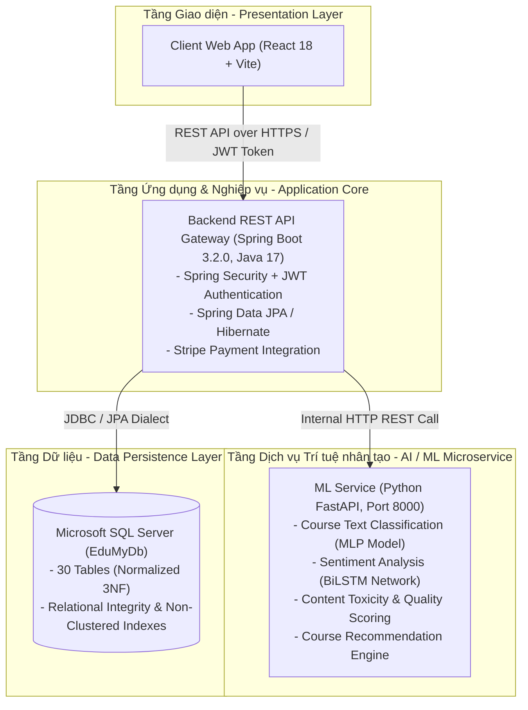

# PHẦN 1: TỔNG QUAN DỰ ÁN & ĐẶC TẢ TÁC NHÂN
*(Project Overview, Architecture & Actor Specification)*

---

## 1.1. BỐI CẢNH DỰ ÁN & MỤC TIÊU HỆ THỐNG

### 1.1.1. Bối cảnh
**Edumy** là nền tảng đào tạo trực tuyến đa đối tượng (eLearning & Course Marketplace Platform) kết hợp công nghệ Trí tuệ nhân tạo (AI/Machine Learning). Nền tảng được xây dựng nhằm giải quyết nhu cầu học tập linh hoạt của học viên, mở rộng cơ hội kinh doanh nội dung số cho giảng viên và tối ưu hóa chi phí vận hành kiểm duyệt khóa học nhờ tự động hóa AI.

### 1.1.2. Mục tiêu hệ thống
1. **Phân phối khóa học đa phương tiện**: Cho phép giảng viên đăng tải giáo trình hoàn chỉnh gồm nhiều chương, bài giảng video, tài liệu xem trước miễn phí (Preview), hệ thống câu hỏi trắc nghiệm (Quiz) đánh giá năng lực và tự động cấp chứng chỉ khi hoàn thành.
2. **Thương mại điện tử & Thanh toán tự động**: Tích hợp luồng giỏ hàng, mã giảm giá (Coupon), tạo đơn hàng và kết nối cổng thanh toán trực tuyến (Stripe / Mock Gateway). Hệ thống tự động kích hoạt ghi danh (Enrollment) ngay khi thanh toán thành công.
3. **Ứng dụng Trí tuệ nhân tạo (AI/ML) vào kiểm duyệt và nâng cao trải nghiệm**:
   - **Tự động phân loại danh mục**: Phân tích tiêu đề và mô tả khóa học để gợi ý danh mục và gắn nhãn thẻ liên quan.
   - **Kiểm duyệt nội dung (Content Moderation)**: Phát hiện từ khóa độc hại/nhạy cảm (Toxicity Detection), chấm điểm chất lượng (Quality Score) và cảnh báo khóa học rủi ro cao để Admin can thiệp.
   - **Phân tích cảm xúc nhận xét (Sentiment Analysis)**: Sử dụng mô hình Deep Learning (BiLSTM) để phân loại đánh giá của học viên (`Positive` / `Negative`), giúp giảng viên nắm bắt nhanh phản hồi chất lượng.
   - **Gợi ý khóa học thông minh (Recommendation Engine)**: Đề xuất các khóa học phù hợp với từng học viên dựa trên lịch sử tìm kiếm và hoạt động tương tác.

---

## 1.2. KIẾN TRÚC GIẢI PHÁP TỔNG THỂ (SYSTEM ARCHITECTURE)

Hệ thống được thiết kế theo kiến trúc hướng dịch vụ (Service-Oriented / Microservices) gồm 4 tầng chính:

### Các thành phần chính:
- **Client (Frontend)**: Xây dựng bằng React 18 và Vite, quản lý trạng thái tập trung (Context API), giao diện tương thích đa thiết bị (Responsive UI).
- **Backend Core**: Xây dựng bằng Spring Boot 3.2.0, quản lý các nghiệp vụ cốt lõi, bảo mật phân quyền đa lớp (Spring Security), xác thực hai lớp (JWT Access Token kết hợp HttpOnly Cookie Refresh Token).
- **AI/ML Service**: Dịch vụ microservice độc lập viết bằng Python FastAPI, phục vụ suy luận mô hình thời gian thực (Real-time Model Inference).
- **Cơ sở dữ liệu**: Microsoft SQL Server lưu trữ toàn bộ dữ liệu quan hệ với 30 bảng chuẩn hóa theo dạng chuẩn 3 (3NF).

---

## 1.3. ĐẶC TẢ TÁC NHÂN HỆ THỐNG (ACTORS SPECIFICATION)

| Tác nhân (Actor) | Định danh | Mô tả & Trách nhiệm |
| :--- | :--- | :--- |
| **Khách vãng lai** | `Anonymous / Guest` | Người dùng chưa đăng nhập. Có thể duyệt danh mục, tìm kiếm khóa học, xem chi tiết khóa học, xem các video học thử (Preview) và tiến hành đăng ký tài khoản. |
| **Học viên** | `Student` | Người học đã đăng nhập. Có thể thêm khóa học vào danh sách yêu thích (Wishlist) hoặc Giỏ hàng (Cart), áp mã giảm giá, thanh toán đơn hàng, theo dõi tiến độ học tập, làm bài kiểm tra trắc nghiệm (Quiz), nhận chứng chỉ (Certificate) và gửi đánh giá/nhận xét (Review). |
| **Giảng viên** | `Instructor` | Người tạo và xuất bản nội dung đào tạo. Có quyền tạo khóa học mới, thiết lập giáo trình (chương, bài học, video), soạn thảo bài kiểm tra Quiz, theo dõi thống kê doanh thu, số lượng học viên và các phân tích cảm xúc từ AI. |
| **Quản trị viên** | `Admin` | Người chịu trách nhiệm vận hành toàn sàn. Quản lý người dùng (khóa/mở tài khoản, phân vai trò), quản lý danh mục & mã giảm giá, kiểm duyệt và phê duyệt xuất bản khóa học, giám sát kết quả AI và ghi đè phân loại nếu cần thiết. |
| **Dịch vụ AI** | `AI / ML Subsystem` | Tác nhân hệ thống tự động thực thi các tác vụ: phân loại danh mục, tính điểm chất lượng, phát hiện độc hại, phân tích sắc thái cảm xúc của bình luận và gợi ý khóa học. |

---

## 1.4. MA TRẬN PHÂN QUYỀN HỆ THỐNG (RBAC MATRIX)

Hệ thống áp dụng mô hình phân quyền dựa trên vai trò (Role-Based Access Control - RBAC). Bảng dưới đây thể hiện chi tiết quyền hạn của từng nhóm người dùng:

| Nhóm chức năng | Khách (Guest) | Học viên (Student) | Giảng viên (Instructor) | Quản trị viên (Admin) |
| :--- | :---: | :---: | :---: | :---: |
| **Xác thực & Tài khoản** | | | | |
| - Đăng ký tài khoản mới | ✔ | ✖ | ✖ | ✖ |
| - Đăng nhập (Local / Google OAuth) | ✔ | ✔ | ✔ | ✔ |
| - Yêu cầu quên mật khẩu & Đặt lại mật khẩu | ✔ | ✔ | ✔ | ✔ |
| - Cập nhật thông tin cá nhân & Ảnh đại diện | ✖ | ✔ | ✔ | ✔ |
| **Duyệt & Tìm kiếm khóa học** | | | | |
| - Xem danh sách khóa học, phân trang & lọc | ✔ | ✔ | ✔ | ✔ |
| - Tìm kiếm khóa học theo từ khóa | ✔ | ✔ | ✔ | ✔ |
| - Xem trang chi tiết khóa học & Đề cương | ✔ | ✔ | ✔ | ✔ |
| - Xem video bài học cho phép học thử (Preview) | ✔ | ✔ | ✔ | ✔ |
| **Thương mại & Thanh toán** | | | | |
| - Quản lý Wishlist (Khóa học yêu thích) | ✖ | ✔ | ✔ | ✔ |
| - Quản lý Giỏ hàng (Thêm / Xóa / Xem giỏ) | ✖ | ✔ | ✔ | ✔ |
| - Áp dụng mã giảm giá (Coupon) | ✖ | ✔ | ✔ | ✔ |
| - Khởi tạo đơn hàng & Thanh toán (Checkout) | ✖ | ✔ | ✔ | ✔ |
| - Xem lịch sử đơn hàng của bản thân | ✖ | ✔ | ✔ | ✔ |
| **Học tập & Đánh giá năng lực** | | | | |
| - Xem toàn bộ video bài giảng trong khóa | ✖ | Chỉ khóa đã ghi danh | Khóa học của mình | ✔ |
| - Đánh dấu hoàn thành bài học & Xem tiến độ | ✖ | Chỉ khóa đã ghi danh | ✖ | ✔ |
| - Làm bài kiểm tra trắc nghiệm (Quiz) & Chấm điểm | ✖ | Chỉ khóa đã ghi danh | ✖ | ✔ |
| - Xem và tải Chứng chỉ tốt nghiệp (Certificate) | ✖ | Khi hoàn thành 100% | ✖ | ✔ |
| - Gửi đánh giá sao & Bình luận khóa học | ✖ | Chỉ khóa đã ghi danh | ✖ | ✔ |
| **Giảng dạy & Quản trị khóa học** | | | | |
| - Soạn thảo khóa học mới (Status: Draft) | ✖ | ✖ | ✔ | ✔ |
| - Thêm chương mục (Section) & Bài học (Lesson) | ✖ | ✖ | Khóa của mình | ✔ |
| - Soạn đề kiểm tra Quiz, Câu hỏi & Đáp án | ✖ | ✖ | Khóa của mình | ✔ |
| - Kích hoạt quét AI kiểm duyệt khóa học | ✖ | ✖ | Khóa của mình | ✔ |
| - Xem Dashboard doanh thu & Học viên của mình | ✖ | ✖ | ✔ | ✖ |
| **Quản trị hệ thống (Admin Only)** | | | | |
| - Phê duyệt xuất bản khóa học (Status: Published) | ✖ | ✖ | ✖ | ✔ |
| - Khóa / Mở khóa tài khoản người dùng | ✖ | ✖ | ✖ | ✔ |
| - Thay đổi vai trò người dùng (Role Assignment) | ✖ | ✖ | ✖ | ✔ |
| - Quản lý Danh mục gốc & Phân cấp danh mục | ✖ | ✖ | ✖ | ✔ |
| - Quản lý Thẻ (Tags) & Mã giảm giá (Coupons) | ✖ | ✖ | ✖ | ✔ |
| - Giám sát báo cáo AI (ML Monitoring & Risk Audits) | ✖ | ✖ | ✖ | ✔ |
| - Phê duyệt hoặc Ghi đè kết quả phân loại của AI | ✖ | ✖ | ✖ | ✔ |
| - Xem báo cáo doanh thu & Thống kê toàn sàn | ✖ | ✖ | ✖ | ✔ |
