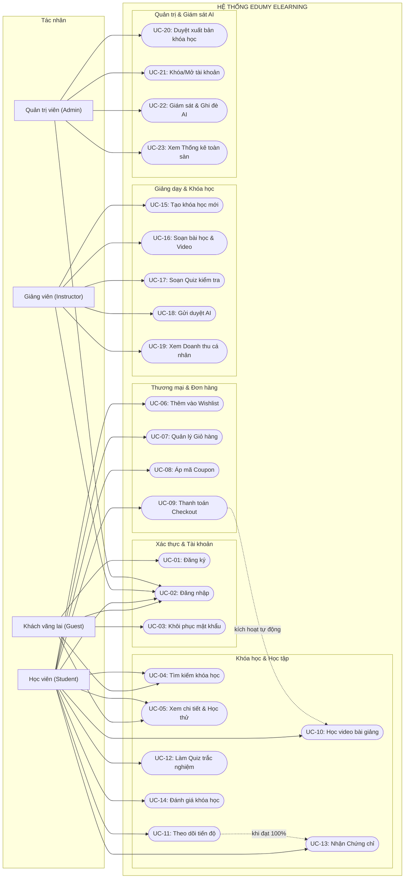

# PHẦN 2: ĐẶC TẢ YÊU CẦU NGHIỆP VỤ & CHỨC NĂNG (SRS)
*(Software Requirements Specification & Use Case Modeling)*

---

## 2.1. ĐẶC TẢ CHI TIẾT CÁC PHÂN HỆ CHỨC NĂNG (FUNCTIONAL REQUIREMENTS)

Hệ thống được phân rã thành **10 phân hệ nghiệp vụ chính**, bao gồm 28 yêu cầu chức năng cốt lõi (FR-01 đến FR-28):

---

### PHÂN HỆ 1: QUẢN LÝ ĐỊNH DANH & XÁC THỰC (AUTHENTICATION & IDENTITY)

- **FR-01: Đăng ký tài khoản (User Registration)**
  - Cho phép người dùng đăng ký tài khoản với Họ tên, Email, Mật khẩu và Vai trò mong muốn (`Student` hoặc `Instructor`).
  - Hệ thống kiểm tra tính duy nhất của Email.
  - Mật khẩu phải được mã hóa một chiều bằng giải thuật an toàn **BCrypt** trước khi lưu vào cơ sở dữ liệu.
  - Tự động tạo giỏ hàng trống (`Carts`) cho tài khoản mới.

- **FR-02: Đăng nhập hệ thống (User Login)**
  - Người dùng đăng nhập bằng Email và Mật khẩu.
  - Hệ thống xác thực mật khẩu băm, kiểm tra trạng thái hoạt động (`IsActive == true`).
  - Trả về **JWT Access Token** (chứa định danh `sub`, `email`, `role`) có hiệu lực 7 ngày.
  - Sinh **Refresh Token** ngẫu nhiên (chuỗi 64-byte bảo mật), lưu trữ trong cơ sở dữ liệu và đính kèm vào HTTP Response dưới dạng Cookie (`HttpOnly`, `Secure`, `SameSite=Lax`).

- **FR-03: Làm mới phiên làm việc an toàn (Token Rotation)**
  - Khi JWT hết hạn, Client gửi yêu cầu kèm Refresh Token từ Cookie.
  - Hệ thống kiểm tra tính hợp lệ của Refresh Token: chưa bị thu hồi (`Revoked == null`) và chưa hết hạn (`Expires > NOW`).
  - Nếu hợp lệ: Cấp một JWT mới, đồng thời **thu hồi Refresh Token cũ** và cấp một Refresh Token mới (cơ chế Token Rotation ngăn chặn replay attack).

- **FR-04: Quên và đặt lại mật khẩu (Password Recovery)**
  - Người dùng nhập Email để yêu cầu khôi phục mật khẩu.
  - Hệ thống tạo một mã khôi phục ngẫu nhiên (`ResetToken`) gồm 8 ký tự với thời gian sống 15 phút (`ResetTokenExpiry`).
  - Người dùng sử dụng Email, mã token và mật khẩu mới để cập nhật thông tin xác thực. Mã token sẽ bị vô hiệu hóa ngay sau khi sử dụng.

- **FR-05: Đăng nhập qua bên thứ ba (Google OAuth)**
  - Hỗ trợ đăng nhập nhanh bằng tài khoản Google. Tự động liên kết hoặc tạo tài khoản mới nếu email chưa tồn tại.

---

### PHÂN HỆ 2: QUẢN LÝ DANH MỤC & GẮN THẺ (CATEGORIES & TAGS)

- **FR-06: Quản lý Danh mục phân cấp (Hierarchical Categories)**
  - Hỗ trợ quản trị viên tạo, sửa, xóa danh mục khóa học.
  - Hỗ trợ quan hệ phân cấp Cha - Con (`ParentCategoryId`) giúp tổ chức cây danh mục nhiều tầng (ví dụ: *Development* -> *Web Development* -> *React*).

- **FR-07: Quản lý Thẻ từ khóa (Tags)**
  - Giảng viên và Admin có thể tạo hoặc gán nhiều thẻ từ khóa cho khóa học (`CourseTags`) phục vụ tìm kiếm nhanh và gợi ý chủ đề liên quan.

---

### PHÂN HỆ 3: QUẢN LÝ KHÓA HỌC & GIÁO TRÌNH (COURSES & CURRICULUM)

- **FR-08: Khởi tạo và cập nhật khóa học (Course Management)**
  - Giảng viên nhập thông tin: Tiêu đề, Mô tả, Giá bán (`Price`), Trình độ (`Level`: *Beginner, Intermediate, Advanced*), Ảnh đại diện (`ThumbnailUrl`).
  - Hệ thống tự động chuyển đổi tiếng Việt có dấu thành chuỗi không dấu thân thiện chuẩn SEO (`Slug`) kèm mã băm ngắn chống trùng lặp.
  - Khóa học khởi tạo ở trạng thái ban đầu là `Draft`.
  - Khi giảng viên chỉnh sửa tiêu đề hoặc mô tả, hệ thống tự động bật cờ `NeedsReanalysis = true` để đánh dấu cần quét lại AI.

- **FR-09: Thiết kế cấu trúc giáo trình (Curriculum Builder)**
  - Khóa học được tổ chức thành nhiều **Chương mục (`CourseSections`)** theo thứ tự `OrderIndex`.
  - Mỗi chương mục chứa nhiều **Bài học (`Lessons`)** với các thuộc tính: Tiêu đề, Video URL, Thời lượng (`Duration`), Thứ tự (`OrderIndex`) và cờ xem thử miễn phí (`IsPreview`).
  - Học viên chưa mua khóa học chỉ được xem các bài học có cờ `IsPreview = true`.

- **FR-10: Vòng đời và trạng thái khóa học (Course Lifecycle)**
  - Quản lý các trạng thái: `Draft` (Bản nháp) ➔ `Analyzing` (Đang phân tích AI) ➔ `NeedsReview` (Phát hiện từ khóa nhạy cảm, cần Admin xem xét) / `PendingApproval` (Chờ duyệt) ➔ `Published` (Đã xuất bản, học viên có thể mua).
  - Chỉ Quản trị viên (Admin) mới có quyền chuyển trạng thái sang `Published`.

---

### PHÂN HỆ 4: ĐÁNH GIÁ TRẮC NGHIỆM (QUIZ & ASSESSMENT)

- **FR-11: Quản lý Đề kiểm tra (Quiz Builder)**
  - Giảng viên có thể tạo đề kiểm tra gắn liền với một chương mục (`CourseSectionId`).
  - Thiết lập tiêu đề, mô tả, điểm số phần trăm tối thiểu để đạt (`PassingScore`, mặc định 80%) và thời gian giới hạn làm bài (`TimeLimitMinutes`).

- **FR-12: Ngân hàng Câu hỏi và Đáp án (Questions & Answers)**
  - Mỗi Quiz bao gồm danh sách các câu hỏi trắc nghiệm (`Questions`) kèm điểm số (`Points`) và phần giải thích chi tiết (`Explanation`).
  - Mỗi câu hỏi gồm nhiều phương án lựa chọn (`Answers`), trong đó có ít nhất một phương án được đánh dấu là đáp án đúng (`IsCorrect = true`).

- **FR-13: Chấm điểm tự động và Lưu lịch sử (Quiz Submission & Auto Grading)**
  - Học viên nộp bài làm: hệ thống ghi nhận lượt làm bài (`QuizAttempt`) và lưu chi tiết các phương án đã chọn (`QuizAttemptAnswers`).
  - Hệ thống tự động đối soát đáp án, tính tổng điểm đạt được, tỷ lệ phần trăm và kết luận trạng thái Đạt (`Passed = true`) hay Chưa đạt kèm lời giải thích.

---

### PHÂN HỆ 5: GIỎ HÀNG, MÃ GIẢM GIÁ & ĐẶT HÀNG (COMMERCE & ORDERS)

- **FR-14: Quản lý Giỏ hàng (Shopping Cart)**
  - Mỗi người dùng có một giỏ hàng cá nhân (`Carts`).
  - Thêm khóa học vào giỏ (`CartItems`): Hệ thống kiểm tra khóa học phải ở trạng thái `Published` và học viên chưa từng ghi danh trước đó.
  - Xem danh sách giỏ hàng, tổng tiền tạm tính và xóa khóa học khỏi giỏ.

- **FR-15: Áp dụng Mã giảm giá (Coupon Application)**
  - Học viên nhập mã giảm giá khi thanh toán.
  - Hệ thống kiểm tra mã tồn tại, cờ `IsActive == true` và thời hạn sử dụng (`ExpiryDate > NOW`).
  - Tự động trừ trực tiếp số tiền theo tỷ lệ phần trăm (`DiscountPercentage`).

- **FR-16: Khởi tạo Đơn hàng (Order Creation)**
  - Chuyển toàn bộ các khóa học trong giỏ hàng thành đơn hàng (`Orders`) ở trạng thái `Pending`.
  - Lưu lại giá bán tại thời điểm mua vào chi tiết đơn hàng (`OrderItems`).
  - Trả về thông tin đơn hàng và chuyển hướng sang cổng thanh toán.

---

### PHÂN HỆ 6: THANH TOÁN & TỰ ĐỘNG GHI DANH (PAYMENT & ENROLLMENT)

- **FR-17: Tích hợp Cổng thanh toán (Payment Gateway Integration)**
  - Kết nối với Stripe Payment Gateway hoặc Mock Payment Gateway cho môi trường kiểm thử.
  - Nhận phản hồi thanh toán qua Webhook / Callback endpoint (`/api/Payment/callback`).

- **FR-18: Xử lý Ghi danh tự động (Auto Enrollment & Inventory Settlement)**
  - Khi thanh toán thành công (`Payment Success`):
    - Đơn hàng chuyển sang trạng thái `Completed`.
    - Tự động tạo bản ghi ghi danh (`Enrollments`) cho từng khóa học trong đơn với tiến độ khởi tạo là 0%.
    - Tăng số lượng học viên (`StudentCount`) của từng khóa học thêm 1.
    - Xóa toàn bộ các mục trong giỏ hàng của học viên.
  - Nếu thanh toán thất bại/hủy: Đơn hàng chuyển sang trạng thái `Cancelled`.

---

### PHÂN HỆ 7: TIẾN ĐỘ HỌC TẬP & CẤP CHỨNG CHỈ (LEARNING & CERTIFICATION)

- **FR-19: Theo dõi Tiến trình học tập (Lesson Progress Tracking)**
  - Học viên xem bài giảng và đánh dấu hoàn thành: ghi nhận một bản ghi vào bảng `LessonProgresses`.

- **FR-20: Tính toán Tỷ lệ hoàn thành (Progress Calculation)**
  - Hệ thống tính toán tiến độ dựa trên tỷ lệ số bài đã học trên tổng số bài học trong khóa:
    $$\text{ProgressPercentage} = \frac{\text{CompletedLessons}}{\text{TotalLessons}} \times 100\%$$

- **FR-21: Tự động Cấp chứng chỉ (Automated Certificate Issuance)**
  - Khi tiến độ đạt chính xác $100\%$, hệ thống tự động sinh một bản ghi `Certificates` kèm mã định danh chứng chỉ duy nhất (`CertificateUrl` dạng UUID).
  - Cho phép học viên xem trực tuyến và chia sẻ chứng chỉ hoàn thành khóa học.

---

### PHÂN HỆ 8: ĐÁNH GIÁ & PHÂN TÍCH CẢM XÚC AI (REVIEWS & SENTIMENT ANALYSIS)

- **FR-22: Đánh giá và Chấm sao khóa học (Course Reviews)**
  - Chỉ những học viên đã ghi danh (`Enrollments`) mới có quyền gửi đánh giá.
  - Học viên chấm điểm sao từ 1 đến 5 và viết nhận xét chi tiết. Mỗi học viên chỉ được đánh giá 1 lần cho mỗi khóa học.
  - Tự động tính toán lại điểm trung bình (`AverageRating`) của khóa học sau mỗi lượt review mới.

- **FR-23: Phân tích Cảm xúc bằng Trí tuệ nhân tạo (AI Sentiment Analysis)**
  - Nội dung nhận xét được gửi sang dịch vụ AI để phân tích bằng mô hình mạng nơ-ron BiLSTM.
  - Gán nhãn cảm xúc `Positive` (Tích cực) hoặc `Negative` (Tiêu cực) kèm điểm tin cậy `SentimentScore`.
  - Kết quả được tổng hợp trên Dashboard giảng viên giúp cải thiện chất lượng giảng dạy.

---

### PHÂN HỆ 9: TƯƠNG TÁC, TÌM KIẾM & ĐỀ XUẤT CÁ NHÂN HÓA (INTERACTIONS & ML RECOMMENDATION)

- **FR-24: Danh sách Yêu thích (Wishlist)**
  - Cho phép học viên lưu các khóa học mong muốn vào danh sách yêu thích để theo dõi hoặc mua sau.

- **FR-25: Ghi nhận Hành vi & Lịch sử tìm kiếm (Tracking & History)**
  - Lưu lại từ khóa người dùng tìm kiếm vào `SearchHistories`.
  - Lưu lại nhật ký tương tác (xem khóa, bắt đầu bài học) vào `UserActivities`.

- **FR-26: Đề xuất Khóa học thông minh (Course Recommendation Engine)**
  - Dựa trên dữ liệu ghi danh và tương tác, mô hình Machine Learning gợi ý danh sách các khóa học phù hợp nhất cho từng học viên tại trang chủ (`/api/Courses/recommend`).

---

### PHÂN HỆ 10: QUẢN TRỊ HỆ THỐNG & GIÁM SÁT AI (ADMIN & MONITORING)

- **FR-27: Quản trị Người dùng & Phê duyệt khóa học (Administration)**
  - Admin có quyền khóa / mở khóa tài khoản (`IsActive`).
  - Admin thay đổi vai trò người dùng (`Admin`, `Instructor`, `Student`).
  - Admin xem xét nội dung và phê duyệt xuất bản khóa học (`Published`).

- **FR-28: Giám sát & Can thiệp kết quả AI (ML Audit & Override)**
  - Bảng điều khiển giám sát hiển thị tổng số lượt phân tích, số khóa học rủi ro cao (`HighRiskCount`), danh sách chờ duyệt.
  - Admin có quyền **Phê duyệt (`Approve`)** kết quả phân loại của AI hoặc **Ghi đè (`Override`)** danh mục theo đánh giá của con người.

---

## 2.2. DANH MỤC CA SỬ DỤNG (USE CASE MATRIX)

| Mã Use Case | Tên Ca sử dụng | Tác nhân chính | Phân hệ liên quan |
| :--- | :--- | :--- | :--- |
| **UC-01** | Đăng ký tài khoản mới | Khách (Guest) | Xác thực & Người dùng |
| **UC-02** | Đăng nhập hệ thống (Local / Google) | Khách, Học viên, Giảng viên, Admin | Xác thực & Người dùng |
| **UC-03** | Khôi phục mật khẩu | Học viên, Giảng viên, Admin | Xác thực & Người dùng |
| **UC-04** | Xem danh sách & Tìm kiếm khóa học | Tất cả tác nhân | Khóa học & Giáo trình |
| **UC-05** | Xem chi tiết khóa học & Học thử | Tất cả tác nhân | Khóa học & Giáo trình |
| **UC-06** | Thêm vào Yêu thích (Wishlist) | Học viên | Tương tác & Khóa học |
| **UC-07** | Quản lý Giỏ hàng (Cart) | Học viên | Thương mại & Đơn hàng |
| **UC-08** | Áp mã giảm giá (Coupon) | Học viên | Thương mại & Đơn hàng |
| **UC-09** | Đặt hàng & Thanh toán (Checkout) | Học viên | Thương mại & Thanh toán |
| **UC-10** | Học bài giảng video | Học viên đã ghi danh | Tiến độ & Học tập |
| **UC-11** | Đánh dấu hoàn thành bài học | Học viên đã ghi danh | Tiến độ & Học tập |
| **UC-12** | Làm bài kiểm tra trắc nghiệm Quiz | Học viên đã ghi danh | Đánh giá & Quiz |
| **UC-13** | Xem và tải Chứng chỉ tốt nghiệp | Học viên đã hoàn thành 100% | Chứng chỉ |
| **UC-14** | Gửi đánh giá & Chấm sao khóa học | Học viên đã ghi danh | Đánh giá & Cảm xúc |
| **UC-15** | Soạn thảo khóa học mới | Giảng viên, Admin | Giảng dạy & Khóa học |
| **UC-16** | Xây dựng giáo trình (Section & Lesson)| Giảng viên, Admin | Giảng dạy & Khóa học |
| **UC-17** | Soạn đề kiểm tra Quiz & Đáp án | Giảng viên, Admin | Đánh giá & Quiz |
| **UC-18** | Gửi khóa học đi phân tích AI | Giảng viên, Admin | AI / ML Subsystem |
| **UC-19** | Xem Dashboard giảng viên & Doanh thu | Giảng viên | Thống kê & Báo cáo |
| **UC-20** | Phê duyệt xuất bản khóa học | Quản trị viên (Admin) | Quản trị hệ thống |
| **UC-21** | Quản lý tài khoản người dùng | Quản trị viên (Admin) | Quản trị hệ thống |
| **UC-22** | Giám sát & Ghi đè phân loại AI | Quản trị viên (Admin) | Giám sát AI |
| **UC-23** | Xem báo cáo tài chính toàn sàn | Quản trị viên (Admin) | Thống kê & Báo cáo |

---

## 2.3. SƠ ĐỒ CA SỬ DỤNG TỔNG QUAN (USE CASE DIAGRAM)

