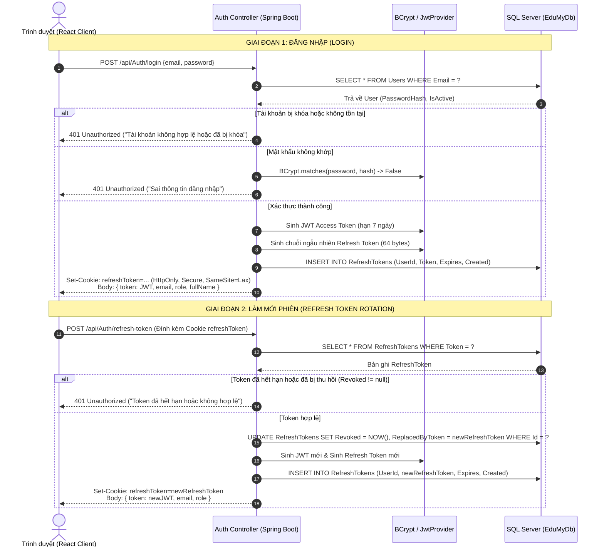
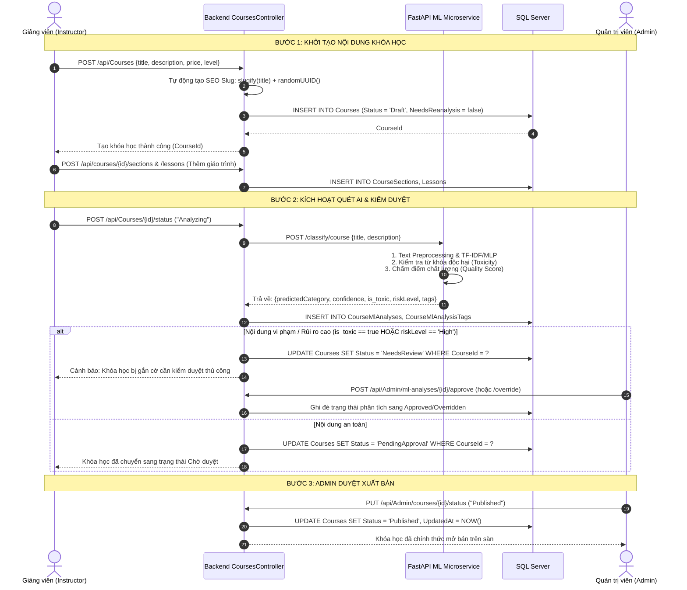
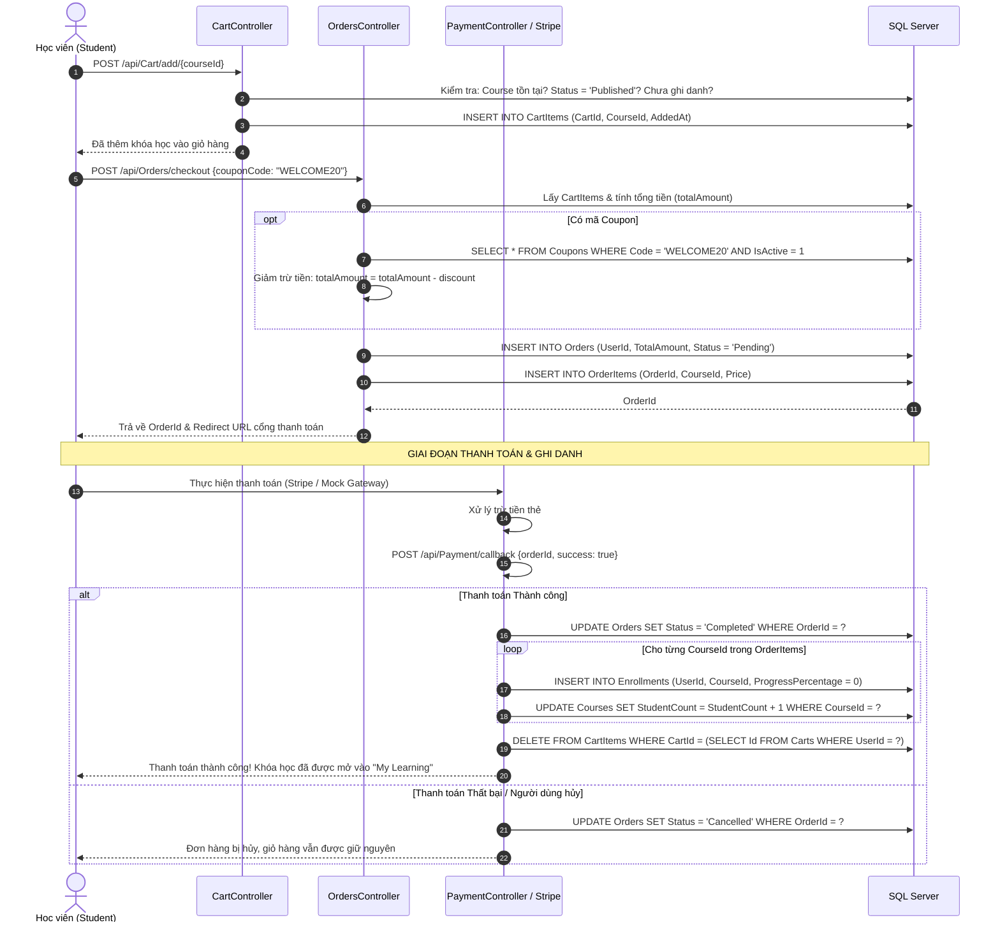
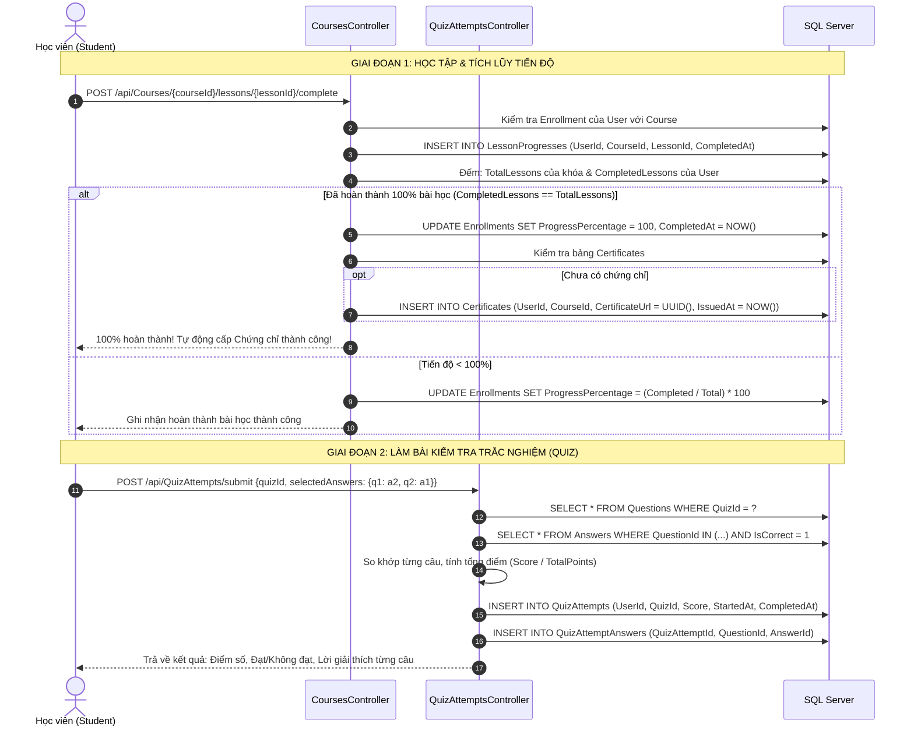
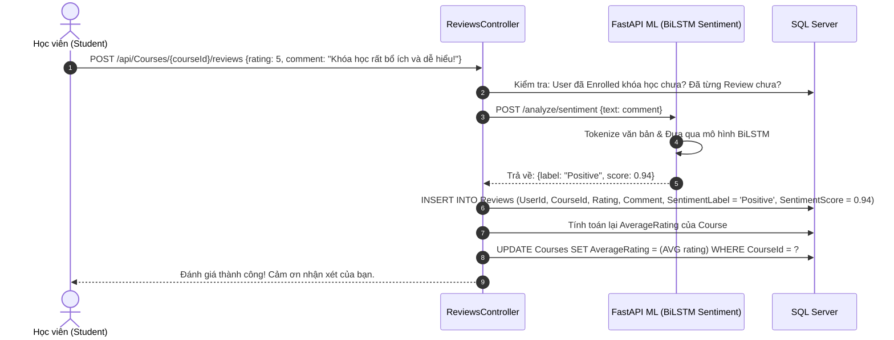

# PHẦN 3: THIẾT KẾ LUỒNG NGHIỆP VỤ CHI TIẾT
*(Business Process Workflows & Interaction Diagrams)*

Tài liệu này mô hình hóa chi tiết các luồng nghiệp vụ xương sống của hệ thống Edumy thông qua các sơ đồ tuần tự (Sequence Diagrams) và lưu đồ xử lý (Activity Flowcharts).

---

## 3.1. LUỒNG XÁC THỰC & LÀM MỚI PHIÊN HAI LỚP TOKEN (JWT + REFRESH TOKEN ROTATION)

Hệ thống kết hợp giữa **JWT Access Token** (lưu trên Client memory) và **Refresh Token** (lưu trong Cookie an toàn `HttpOnly`, `Secure`). Khi người dùng đăng nhập hoặc gia hạn phiên, hệ thống áp dụng cơ chế xoay vòng Refresh Token (Token Rotation) nhằm vô hiệu hóa token cũ, chống tấn công giả mạo phiên.

---

## 3.2. LUỒNG GIẢNG VIÊN TẠO KHÓA HỌC, AI KIỂM DUYỆT & ADMIN DUYỆT XUẤT BẢN

Luồng xuất bản khóa học bảo vệ nền tảng khỏi nội dung xấu độc thông qua bước quét tự động từ AI Microservice trước khi chuyển sang cho Quản trị viên duyệt lần cuối:

---

## 3.3. LUỒNG GIỎ HÀNG, ĐẶT HÀNG & THANH TOÁN TỰ ĐỘNG GHI DANH

Mô tả trọn vẹn chu trình thương mại điện tử từ lúc thêm khóa học vào giỏ, áp mã giảm giá, chuyển hướng thanh toán đến khi nhận phản hồi và kích hoạt quyền học:

---

## 3.4. LUỒNG HỌC TẬP, LÀM BÀI QUIZ TRẮC NGHIỆM & CẤP CHỨNG CHỈ TỰ ĐỘNG

Mô hình hóa quá trình người học tương tác với bài giảng video, tích lũy tiến trình hoàn thành, vượt qua bài kiểm tra đánh giá và nhận chứng chỉ tự động:

---

## 3.5. LUỒNG ĐÁNH GIÁ KHÓA HỌC & PHÂN TÍCH CẢM XÚC NHẬN XÉT BẰNG AI

