# PHẦN 4: THIẾT KẾ KIẾN TRÚC DỮ LIỆU & SƠ ĐỒ THỰC THỂ (ERD)
*(Data Architecture & Entity Relationship Diagram)*

---

## 4.1. NGUYÊN TẮC THIẾT KẾ CƠ SỞ DỮ LIỆU

Cơ sở dữ liệu của hệ thống Edumy được thiết kế theo các tiêu chuẩn công nghiệp nhằm đảm bảo tính toàn vẹn dữ liệu, hiệu năng cao và khả năng mở rộng:

1. **Chuẩn hóa dạng chuẩn 3 (3NF - Third Normal Form)**:
   - **1NF**: Mọi thuộc tính đều là đơn trị (atomic), không có nhóm lặp.
   - **2NF**: Đạt 1NF và mọi thuộc tính không khóa đều phụ thuộc hàm toàn phần vào khóa chính (đặc biệt trong các bảng liên kết N-N như `UserRoles`, `CourseTags`, `CourseCoupons`).
   - **3NF**: Đạt 2NF và không tồn tại phụ thuộc bắc cầu (transitive dependencies) giữa các thuộc tính không khóa.

2. **Quy ước đặt tên & Kiểu dữ liệu**:
   - Tên bảng: Sử dụng danh từ số nhiều, viết theo quy tắc PascalCase (ví dụ: `Users`, `Courses`, `CourseSections`, `OrderItems`).
   - Khóa chính (PK): Sử dụng kiểu số nguyên tự tăng `INT IDENTITY(1,1)` để tối ưu hóa việc đánh chỉ mục Clustered Index, hoặc Composite Key cho các bảng liên kết.
   - Thời gian: Sử dụng `DATETIME2` với giá trị mặc định hệ thống `SYSUTCDATETIME()` để đạt độ chính xác cao và hỗ trợ chuẩn hóa múi giờ quốc tế (UTC).
   - Tiền tệ & Phần trăm: Sử dụng `DECIMAL(18,2)` cho giá bán/doanh thu và `DECIMAL(5,2)` cho tỷ lệ giảm giá, triệt tiêu sai số làm tròn số thực.
   - Văn bản: Sử dụng `NVARCHAR` có độ dài thích hợp để hỗ trợ lưu trữ tiếng Việt có dấu chuẩn Unicode.

3. **Chiến lược toàn vẹn tham chiếu & Xử lý Cascade trong SQL Server**:
   - SQL Server không cho phép thiết lập `ON DELETE CASCADE` trên nhiều đường dẫn cùng trỏ đến một bảng con nếu tạo thành chu trình hoặc đa đường dẫn (Multiple Cascade Paths / Cycles).
   - Giải pháp: Áp dụng `ON DELETE CASCADE` trên các quan hệ Phụ thuộc trực tiếp mạnh (ví dụ: `Courses` -> `CourseSections` -> `Lessons`), và sử dụng `ON DELETE NO ACTION` / `SET NULL` trên các quan hệ phụ thuộc chéo (ví dụ: `Users` -> `Courses` -> `OrderItems` và `Orders` -> `OrderItems`).

---

## 4.2. PHÂN LOẠI 30 THỰC THỂ THEO NHÓM CHỨC NĂNG

Hệ thống bao gồm chính xác **30 bảng dữ liệu** được tổ chức thành 7 phân nhóm nghiệp vụ:

| Nhóm | Tên nhóm | Số bảng | Danh sách các bảng | Ý nghĩa nghiệp vụ |
| :---: | :--- | :---: | :--- | :--- |
| **I** | **Người dùng & Xác thực** | 4 | `Users`, `Roles`, `UserRoles`, `RefreshTokens` | Quản lý tài khoản, thông tin cá nhân, phân quyền RBAC và phiên làm việc bảo mật. |
| **II** | **Danh mục & Phân loại** | 3 | `Categories`, `Tags`, `CourseTags` | Cây danh mục khóa học cha-con và hệ thống nhãn thẻ từ khóa. |
| **III** | **Khóa học & Giáo trình** | 3 | `Courses`, `CourseSections`, `Lessons` | Quản lý thông tin khóa học, các chương mục và từng bài giảng video. |
| **IV** | **Đánh giá trắc nghiệm (Quiz)** | 5 | `Quizzes`, `Questions`, `Answers`, `QuizAttempts`, `QuizAttemptAnswers` | Ngân hàng đề thi, câu hỏi trắc nghiệm, đáp án và chấm điểm tự động. |
| **V** | **Thương mại & Thanh toán** | 6 | `Carts`, `CartItems`, `Coupons`, `CourseCoupons`, `Orders`, `OrderItems` | Giỏ hàng, mã giảm giá, đơn hàng và lịch sử thanh toán. |
| **VI** | **Học tập & Tương tác** | 5 | `Enrollments`, `LessonProgresses`, `Certificates`, `Reviews`, `Wishlists` | Ghi danh học tập, tiến độ hoàn thành bài, cấp chứng chỉ tốt nghiệp, đánh giá nhận xét và danh sách yêu thích. |
| **VII** | **AI/ML & Hành vi người dùng** | 4 | `CourseMlAnalyses`, `CourseMlAnalysisTags`, `SearchHistories`, `UserActivities` | Nhật ký phân tích tự động của AI, kiểm duyệt độc hại, lịch sử tìm kiếm và tương tác phục vụ đề xuất khóa học. |

---

## 4.3. SƠ ĐỒ THỰC THỂ LIÊN KẾT TỔNG THỂ (MERMAID ERD)

```mermaid
erDiagram
    %% ==========================================
    %% NHÓM I: NGƯỜI DÙNG & XÁC THỰC
    %% ==========================================
    Users {
        int UserId PK
        nvarchar FullName
        nvarchar Email UK
        nvarchar PasswordHash
        nvarchar Role
        bit IsActive
        datetime2 CreatedAt
        nvarchar ResetToken
        datetime2 ResetTokenExpiry
    }

    Roles {
        int Id PK
        nvarchar Name UK
    }

    UserRoles {
        int UserId PK, FK
        int RoleId PK, FK
    }

    RefreshTokens {
        int Id PK
        int UserId FK
        nvarchar Token
        datetime2 Expires
        datetime2 Created
        datetime2 Revoked
        nvarchar ReplacedByToken
    }

    Users ||--o{ UserRoles : "assigned"
    Roles ||--o{ UserRoles : "granted_to"
    Users ||--o{ RefreshTokens : "owns"

    %% ==========================================
    %% NHÓM II & III: DANH MỤC & KHÓA HỌC
    %% ==========================================
    Categories {
        int CategoryId PK
        nvarchar Name
        nvarchar Description
        int ParentCategoryId FK
    }

    Tags {
        int Id PK
        nvarchar Name UK
    }

    Courses {
        int CourseId PK
        int InstructorId FK
        int CategoryId FK
        nvarchar Title
        nvarchar Slug UK
        decimal Price
        nvarchar Level
        nvarchar Status
        float AverageRating
        int StudentCount
        bit NeedsReanalysis
        datetime2 CreatedAt
    }

    CourseTags {
        int CourseId PK, FK
        int TagId PK, FK
    }

    CourseSections {
        int SectionId PK
        int CourseId FK
        nvarchar Title
        int OrderIndex
    }

    Lessons {
        int LessonId PK
        int SectionId FK
        nvarchar Title
        nvarchar VideoUrl
        int Duration
        int OrderIndex
        bit IsPreview
    }

    Categories ||--o{ Categories : "parent_of"
    Categories ||--o{ Courses : "categorizes"
    Users ||--o{ Courses : "instructs"
    Courses ||--o{ CourseTags : "has_tag"
    Tags ||--o{ CourseTags : "tagged_in"
    Courses ||--o{ CourseSections : "contains"
    CourseSections ||--o{ Lessons : "has_lesson"

    %% ==========================================
    %% NHÓM IV: BÀI KIỂM TRA TRẮC NGHIỆM (QUIZ)
    %% ==========================================
    Quizzes {
        int QuizId PK
        int CourseSectionId FK
        nvarchar Title
        int PassingScore
        int TimeLimitMinutes
    }

    Questions {
        int QuestionId PK
        int QuizId FK
        nvarchar Content
        int Points
        nvarchar Explanation
    }

    Answers {
        int AnswerId PK
        int QuestionId FK
        nvarchar Content
        bit IsCorrect
    }

    QuizAttempts {
        int QuizAttemptId PK
        int UserId FK
        int QuizId FK
        int Score
        datetime2 StartedAt
        datetime2 CompletedAt
    }

    QuizAttemptAnswers {
        int QuizAttemptAnswerId PK
        int QuizAttemptId FK
        int QuestionId FK
        int AnswerId FK
    }

    CourseSections ||--o{ Quizzes : "has_quiz"
    Quizzes ||--o{ Questions : "contains"
    Questions ||--o{ Answers : "options"
    Users ||--o{ QuizAttempts : "submits"
    Quizzes ||--o{ QuizAttempts : "attempted_in"
    QuizAttempts ||--o{ QuizAttemptAnswers : "includes"
    Questions ||--o{ QuizAttemptAnswers : "target_question"
    Answers ||--o{ QuizAttemptAnswers : "selected_answer"

    %% ==========================================
    %% NHÓM V: THƯƠNG MẠI & THANH TOÁN
    %% ==========================================
    Carts {
        int Id PK
        int UserId UK, FK
        datetime2 CreatedAt
        datetime2 UpdatedAt
    }

    CartItems {
        int Id PK
        int CartId FK
        int CourseId FK
        datetime2 AddedAt
    }

    Coupons {
        int Id PK
        nvarchar Code UK
        decimal DiscountPercentage
        datetime2 ExpiryDate
        bit IsActive
    }

    CourseCoupons {
        int CourseId PK, FK
        int CouponId PK, FK
    }

    Orders {
        int OrderId PK
        int UserId FK
        decimal TotalAmount
        nvarchar Status
        datetime2 CreatedAt
    }

    OrderItems {
        int OrderItemId PK
        int OrderId FK
        int CourseId FK
        decimal Price
    }

    Users ||--o| Carts : "possesses"
    Carts ||--o{ CartItems : "holds"
    Courses ||--o{ CartItems : "in_cart"
    Coupons ||--o{ CourseCoupons : "discount_rules"
    Courses ||--o{ CourseCoupons : "applies_discount"
    Users ||--o{ Orders : "places"
    Orders ||--o{ OrderItems : "has_item"
    Courses ||--o{ OrderItems : "purchased_as"

    %% ==========================================
    %% NHÓM VI: HỌC TẬP & TƯƠNG TÁC
    %% ==========================================
    Enrollments {
        int EnrollmentId PK
        int UserId FK
        int CourseId FK
        datetime2 EnrolledAt
        int ProgressPercentage
        datetime2 CompletedAt
    }

    LessonProgresses {
        int Id PK
        int UserId FK
        int CourseId FK
        int LessonId FK
        datetime2 CompletedAt
    }

    Certificates {
        int Id PK
        int UserId FK
        int CourseId FK
        nvarchar CertificateUrl
        datetime2 IssuedAt
    }

    Reviews {
        int ReviewId PK
        int UserId FK
        int CourseId FK
        int Rating
        nvarchar Comment
        nvarchar SentimentLabel
        float SentimentScore
        datetime2 CreatedAt
    }

    Wishlists {
        int Id PK
        int UserId FK
        int CourseId FK
        datetime2 AddedAt
    }

    Users ||--o{ Enrollments : "enrolls"
    Courses ||--o{ Enrollments : "enrolled_by"
    Users ||--o{ LessonProgresses : "studies"
    Courses ||--o{ LessonProgresses : "studied_in"
    Lessons ||--o{ LessonProgresses : "finished_lesson"
    Users ||--o{ Certificates : "awarded_to"
    Courses ||--o{ Certificates : "certifies"
    Users ||--o{ Reviews : "writes"
    Courses ||--o{ Reviews : "evaluated_in"
    Users ||--o{ Wishlists : "likes"
    Courses ||--o{ Wishlists : "wished_in"

    %% ==========================================
    %% NHÓM VII: AI/ML & HÀNH VI
    %% ==========================================
    CourseMlAnalyses {
        int Id PK
        int CourseId FK
        nvarchar PrimaryCategory
        float Confidence
        int QualityScore
        nvarchar RiskLevel
        nvarchar Status
        datetime2 CreatedAt
        int ApprovedByUserId FK
    }

    CourseMlAnalysisTags {
        int Id PK
        int CourseMlAnalysisId FK
        nvarchar TagName
        float Confidence
    }

    SearchHistories {
        int Id PK
        int UserId FK
        nvarchar SearchQuery
        datetime2 SearchedAt
    }

    UserActivities {
        int Id PK
        int UserId FK
        nvarchar ActivityType
        nvarchar ResourceId
        datetime2 Timestamp
    }

    Courses ||--o{ CourseMlAnalyses : "analyzed_by_ai"
    Users ||--o{ CourseMlAnalyses : "approved_by_admin"
    CourseMlAnalyses ||--o{ CourseMlAnalysisTags : "suggests_tags"
    Users ||--o{ SearchHistories : "searched_by"
    Users ||--o{ UserActivities : "performed_by"
```

