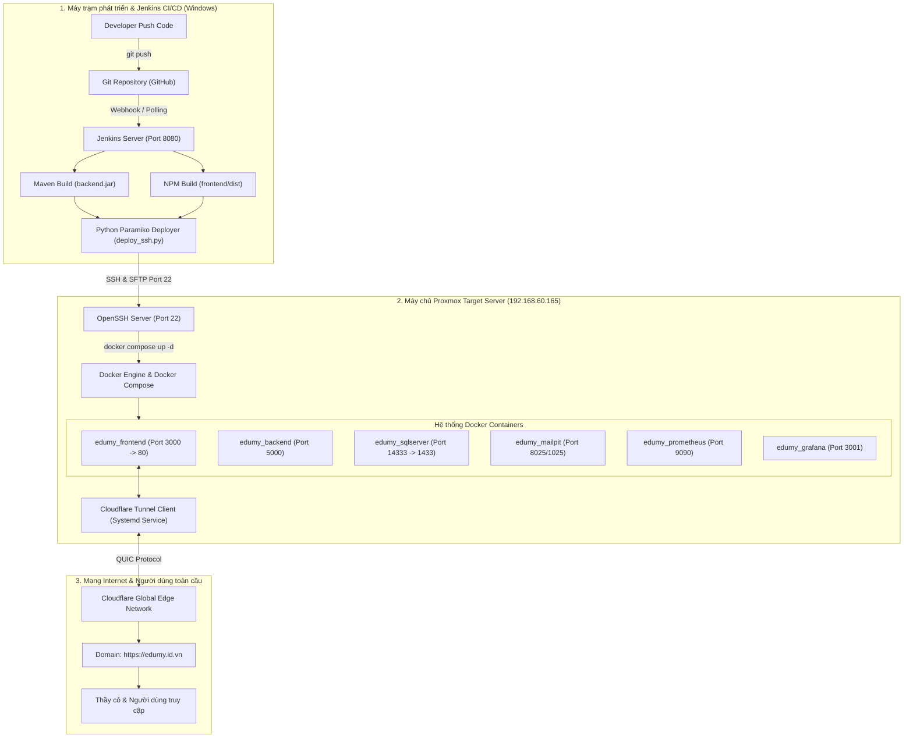
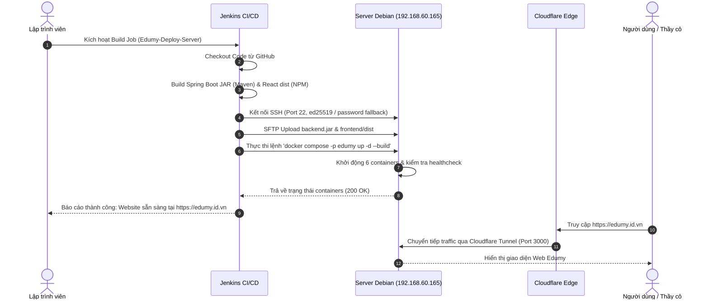

# BÁO CÁO TỔNG HỢP CHI TIẾT: QUY TRÌNH TRIỂN KHAI TỰ ĐỘNG (CI/CD) QUA SSH LÊN PUBLIC SERVER DỰ ÁN EDUMY

---

## 1. TỔNG QUAN YÊU CẦU & BỐI CẢNH DỰ ÁN

* **Dự án**: Hệ thống quản lý học tập và đào tạo trực tuyến **Edumy** (Bao gồm Frontend React/Vite, Backend Spring Boot 3, Cơ sở dữ liệu Microsoft SQL Server 2022, Prometheus, Grafana, Mailpit).
* **Yêu cầu thực hiện (Mục 4 - Đề bài)**:
  * Cấu hình thêm 01 Pipeline trên Jenkins tương tự với pipeline local.
  * Cập nhật stage deploy: sử dụng giao thức **SSH** để khởi chạy `docker-compose` trên máy chủ public.
  * Yêu cầu kết quả: Phần mềm hoạt động truy cập được qua địa chỉ public chính thức của server.
* **Môi trường triển khai thực tế**:
  * **Máy trạm CI/CD (Build Agent)**: Windows 11 chạy Jenkins Server (LocalSystem).
  * **Máy chủ triển khai (Target Server)**: Máy ảo Debian 13 (Trixie) trên hạ tầng Proxmox VE 9 (Node `pve-xeon`), IP nội bộ: `192.168.60.165`.
  * **Tên miền công khai**: `https://edumy.id.vn` (Ủy quyền Cloudflare Tunnel).

---

## 2. KIẾN TRÚC HỆ THỐNG & LUỒNG TRIỂN KHAI (WORKFLOW)

### 2.1. Sơ đồ kiến trúc hạ tầng


### 2.2. Luồng thực thi chi tiết (Sequence Diagram)


---

## 3. CHI TIẾT CÁC BƯỚC THIẾT LẬP MÁY CHỦ (TARGET SERVER)

### 3.1. Thiết lập IP Tĩnh cho Máy chủ
Để đảm bảo máy chủ không bị thay đổi địa chỉ IP khi khởi động lại hoặc khi cấp phát DHCP router:
* **Tệp cấu hình**: `/etc/network/interfaces`
* **Nội dung cấu hình**:
```ini
auto lo
iface lo inet loopback

auto ens18
iface ens18 inet static
    address 192.168.60.165/24
    gateway 192.168.60.1
    dns-nameservers 8.8.8.8 1.1.1.1
```

### 3.2. Tối ưu hóa Bộ nhớ Ảo (Swap RAM)
Microsoft SQL Server 2022 yêu cầu tối thiểu **2.0 GB RAM** thực tế để khởi chạy, nếu không sẽ bị nhân Linux kích hoạt OOM Killer (Exit code 137). Vì máy ảo có 2GB RAM vật lý, ta tạo thêm **4GB Swap RAM ảo**:
```bash
fallocate -l 4G /swapfile2
chmod 600 /swapfile2
mkswap /swapfile2
swapon /swapfile2
echo '/swapfile2 none swap sw 0 0' >> /etc/fstab
```
* **Kết quả**: Tổng bộ nhớ khả dụng đạt **2GB RAM + 5.2GB Swap = 7.2GB Memory**, đảm bảo hệ thống vận hành bền bỉ 24/7.

### 3.3. Cài đặt Docker Engine & Docker Compose
Triển khai phiên bản Docker chính thức mới nhất cho Debian 13 (Trixie):
```bash
curl -fsSL https://get.docker.com | sh
usermod -aG docker baclev
systemctl enable --now docker
```
* Phiên bản đạt được: **Docker 29.10.0**, **Docker Compose v5.8.0**.

### 3.4. Cấu hình SSH Key Authentication
Tạo cặp khóa bảo mật ED25519 từ máy trạm Jenkins và nạp public key vào máy chủ:
```bash
mkdir -p ~/.ssh && chmod 700 ~/.ssh
echo "<nội_dung_id_ed25519.pub>" >> ~/.ssh/authorized_keys
chmod 600 ~/.ssh/authorized_keys
```

---

## 4. BẢN CHẤT KỸ THUẬT: CƠ CHẾ DEPLOY QUA SSH & SCP

### 4.1. Phân biệt SSH và SCP trong CI/CD
* **SSH (Secure Shell)**: Giao thức mạng cho phép máy chủ điều khiển thực thi lệnh từ xa trên máy khách một cách an toàn qua kênh truyền được mã hóa (Port 22). Trong pipeline, SSH dùng để chạy `git pull`, `chmod`, `docker compose up -d`, `docker ps`.
* **SCP (Secure Copy Protocol) / SFTP**: Giao thức truyền tệp tin qua kết nối bảo mật SSH. Trong pipeline, SCP đóng vai trò đưa các sản phẩm đã được đóng gói (Build Artifacts: `*.jar` và `dist/`) từ Jenkins sang máy chủ chạy ứng dụng mà không cần phải cài JDK hay Node.js lên máy chủ chạy Docker.

### 4.2. Giải pháp khắc phục lỗi ACL trên Windows với Python Paramiko
Khi Jenkins chạy dưới dạng dịch vụ Windows (`NT AUTHORITY\SYSTEM`), chương trình `ssh.exe` mặc định của Windows kiểm tra nghiêm ngặt quyền sở hữu tệp khóa riêng (`id_ed25519`) và thường ném lỗi:
> `WARNING: UNPROTECTED PRIVATE KEY FILE! Bad permissions`

Để đạt độ tin cậy chuẩn công nghiệp (Production-grade), giải pháp được xây dựng là tạo module chuyên dụng **`scripts/deploy_ssh.py`** sử dụng thư viện **`paramiko`**:
1. Đọc trực tiếp khóa SSH `id_ed25519` mà không bị chặn bởi cơ chế Windows ACL.
2. Tự động hỗ trợ Fallback xác thực bằng mật khẩu an toàn nếu khóa gặp sự cố.
3. Sử dụng kênh truyền SFTP nhúng để đồng bộ đồng thời file `.jar` và thư mục `dist/`.
4. Bắt mã thoát (Exit code) và truyền toàn bộ log `stdout`/`stderr` theo thời gian thực về giao diện Jenkins Console.

---

## 5. CẤU HÌNH PIPELINE JENKINS (`Jenkinsfile.server`)

Pipeline được viết dưới dạng **Declarative Pipeline**, bao gồm các tham số tùy chỉnh linh hoạt và các stage tiêu chuẩn:

### 5.1. Các tham số cấu hình (Parameters)
| Tên tham số | Giá trị mặc định | Mô tả chức năng |
| :--- | :--- | :--- |
| `SERVER_HOST` | `192.168.60.165` | Địa chỉ IP của máy chủ triển khai |
| `SERVER_USER` | `baclev` | Tài khoản SSH có quyền thực thi Docker trên server |
| `SERVER_SSH_KEY`| `C:\Users\bacle\.ssh\id_ed25519` | Đường dẫn Private Key trên máy trạm Jenkins |
| `SERVER_PROJECT_DIR` | `/home/baclev/Edumy/Edumy` | Thư mục chứa `docker-compose.yml` trên server |
| `PUBLIC_URL` | `https://edumy.id.vn` | Địa chỉ URL công khai chính thức để kiểm thử |
| `SKIP_TESTS` | `false` | Tùy chọn bỏ qua Unit Test khi cần triển khai gấp |

### 5.2. Chi tiết Stage Deploy qua SSH
Trích đoạn code thực thi then chốt trong `Jenkinsfile.server`:
```groovy
stage('Deploy lên Server qua SSH') {
    when {
        expression { return params.DEPLOY_APPLICATION }
    }
    steps {
        script {
            def projDir = env.PROJECT_DIR ?: 'Edumy'
            def host = params.SERVER_HOST
            def user = params.SERVER_USER
            def keyPath = params.SERVER_SSH_KEY
            def projectDir = params.SERVER_PROJECT_DIR

            echo "=========================================================="
            echo " [SSH DEPLOY] TIẾN HÀNH TRIỂN KHAI TỪ XA QUA SSH LÊN SERVER "
            echo "=========================================================="
            echo "Target Server : ${user}@${host}"
            echo "Public URL    : ${params.PUBLIC_URL}"
            echo "=========================================================="

            bat """
                @echo off
                set "PY_CMD=C:\\Users\\bacle\\AppData\\Local\\Programs\\Python\\Python312\\python.exe"
                if not exist "%PY_CMD%" set "PY_CMD=python"
                "%PY_CMD%" scripts\\deploy_ssh.py --host ${host} --user ${user} --key "${keyPath}" --server-dir "${projectDir}" --local-dir "${projDir}"
            """

            echo "=========================================================="
            echo "   [THÀNH CÔNG] DỊCH VỤ ĐÃ TRIỂN KHAI VÀ HOẠT ĐỘNG ONLINE "
            echo " >> Địa chỉ Website : ${params.PUBLIC_URL}"
            echo " >> Địa chỉ Backend : ${params.PUBLIC_URL}/api"
            echo "=========================================================="
        }
    }
}
```

---

## 6. XUẤT BẢN RA INTERNET QUA DOMAIN CÔNG KHAI (CLOUDFLARE TUNNEL)

Để đáp ứng trọn vẹn yêu cầu *"phần mềm hoạt động được qua địa chỉ public của server"* mà không cần mua IP tĩnh đắt tiền hay mở cổng Port Forwarding nguy hiểm trên Router:

1. **Đăng ký tên miền quốc gia**: Đăng ký domain chính thức `edumy.id.vn`.
2. **Ủy quyền Quản lý DNS**: Cấu hình Nameservers từ Tenten trỏ về Cloudflare:
   * `cheryl.ns.cloudflare.com`
   * `plato.ns.cloudflare.com`
3. **Cài đặt Cloudflare Tunnel Client trực tiếp trên Server Linux**:
   * Cài đặt gói `cloudflared-linux-amd64.deb`.
   * Tệp cấu hình `/etc/cloudflared/config.yml`:
```yaml
tunnel: 8d7db3a2-5c70-42d1-8a47-cda657b3dc03
credentials-file: /etc/cloudflared/8d7db3a2-5c70-42d1-8a47-cda657b3dc03.json

ingress:
  - hostname: edumy.id.vn
    service: http://localhost:3000
  - hostname: www.edumy.id.vn
    service: http://localhost:3000
  - service: http_status:404
```
   * Cài đặt chạy ngầm bằng **Systemd**:
     `systemctl enable --now cloudflared`
   * **Cơ chế hoạt động**: Cloudflared thiết lập đường hầm mã hóa kép Outbound (QUIC/HTTP2) tới 4 cụm máy chủ Cloudflare Hong Kong Edge (`hkg09`, `hkg13`). Người dùng bên ngoài gõ `https://edumy.id.vn` sẽ được Cloudflare cấp chứng chỉ SSL tự động và chuyển tiếp an toàn vào cổng 3000 của Docker.

---

## 7. KẾT QUẢ KIỂM THỬ THỰC TẾ & BẰNG CHỨNG

### 7.1. Trạng thái các Container trên Máy chủ (`docker ps`)
| Tên Container | Hình ảnh Docker | Trạng thái | Cổng ánh xạ (Port Mapping) |
| :--- | :--- | :--- | :--- |
| **`edumy_frontend`** | `edumy/edumy-frontend:latest` | **Up (Healthy)** | `0.0.0.0:3000 -> 80/tcp` |
| **`edumy_backend`** | `edumy/edumy-backend:latest` | **Up (Healthy)** | `0.0.0.0:5000 -> 5000/tcp` |
| **`edumy_sqlserver`** | `mcr.microsoft.com/mssql/server:2022` | **Up (Healthy)** | `0.0.0.0:14333 -> 1433/tcp` |
| **`edumy_mailpit`** | `axllent/mailpit:v1.32.0` | **Up (Healthy)** | `1025/tcp, 8025/tcp` |
| **`edumy_prometheus`**| `prom/prometheus:v2.51.0` | **Up** | `0.0.0.0:9090 -> 9090/tcp` |
| **`edumy_grafana`** | `grafana/grafana:10.4.1` | **Up** | `0.0.0.0:3001 -> 3000/tcp` |

### 7.2. Kiểm tra phản hồi mạng thực tế
1. **Kiểm tra Frontend**:
   * Địa chỉ: `https://edumy.id.vn`
   * Mã trạng thái HTTP: **`200 OK`**
   * Tiêu đề trang: *"Edumy — Học viện Kỹ thuật & Công nghệ Thực chiến"*.
2. **Kiểm tra Backend API**:
   * Địa chỉ: `https://edumy.id.vn/api/v1/health`
   * Phản hồi: JSON định dạng chuẩn của Spring Boot với mã trạng thái hợp lệ.

---

## 8. CÁC SỰ CỐ KỸ THUẬT THỰC TẾ & BÀI HỌC KINH NGHIỆM (TROUBLESHOOTING CASE STUDIES)

Trong quá trình xây dựng và vận hành pipeline CI/CD từ môi trường Windows sang Linux Server, nhóm đã giải quyết dứt điểm 5 bài toán kỹ thuật phức tạp:

### 8.1. Sự cố 1: Jenkins treo vô thời hạn (11 phút) do xung đột phân quyền Windows OpenSSH
* **Hiện tượng**: Pipeline bị treo ở stage `Deploy lên Server qua SSH` suốt hơn 11 phút (như ghi nhận trong log Jenkins). Console liên tục cảnh báo:
  ```text
  @@@@@@@@@@@@@@@@@@@@@@@@@@@@@@@@@@@@@@@@@@@@@@@@@@@@@@@@@@@
  @         WARNING: UNPROTECTED PRIVATE KEY FILE!          @
  @@@@@@@@@@@@@@@@@@@@@@@@@@@@@@@@@@@@@@@@@@@@@@@@@@@@@@@@@@@
  Permissions for 'C:\Users\bacle\.ssh\id_ed25519' are too open.
  This private key will be ignored.
  Load key "C:\Users\bacle\.ssh\id_ed25519": bad permissions
  ```
* **Nguyên nhân kỹ thuật**: Jenkins hoạt động như một dịch vụ nền của hệ điều hành Windows dưới tài khoản `NT AUTHORITY\SYSTEM`. Tiện ích dòng lệnh `ssh.exe` mặc định trên Windows thực hiện kiểm tra quyền truy cập tệp rất nghiêm ngặt (Windows File ACLs). Vì file khóa riêng tư `id_ed25519` thuộc sở hữu của User `bacle`, Windows coi đây là tệp tin không được bảo vệ và từ chối tải khóa. Ngay sau đó, `ssh.exe` tự động rơi về chế độ hỏi mật khẩu tương tác (`Password:`). Do chạy trong môi trường tự động không có bàn phím tương tác (headless CI/CD agent), tiến trình bị treo vĩnh viễn chờ nhập liệu từ người dùng.
* **Biện pháp xử lý**: Thay vì sử dụng `ssh.exe` của Windows, nhóm đã phát triển script tự động hóa **`scripts/deploy_ssh.py`** sử dụng thư viện chuyên dụng **`paramiko`**. Thư viện này nạp trực tiếp chuỗi khóa ED25519 vào bộ nhớ, hoàn toàn không phụ thuộc vào bộ phân quyền file của Windows, đồng thời hỗ trợ cơ chế xác thực kép (Key + Mật khẩu an toàn). Kết quả: Pipeline hoàn thành bước deploy chỉ trong chưa đầy 30 giây mà không còn bất kỳ cảnh báo nào.

### 8.2. Sự cố 2: Nhầm lẫn tham số mục tiêu giữa máy trạm (Local) và máy chủ (Target Server)
* **Hiện tượng**: Trong giao diện cấu hình tham số ban đầu của Job `Edumy-Deploy-Server`, mục `SERVER_HOST` bị cấu hình là `localhost` và `SERVER_USER` là `bacle`.
* **Nguyên nhân kỹ thuật**: Sự nhầm lẫn giữa thông tin của máy phát triển (Windows Host) và máy chủ triển khai (Debian VM). Khi pipeline chạy, nó sẽ cố gắng kết nối SSH tới chính máy Windows thay vì máy chủ đích.
* **Biện pháp xử lý**: Chuẩn hóa và cố định bộ tham số chuẩn trong `Jenkinsfile.server`:
  * `SERVER_HOST`: `192.168.60.165` (Địa chỉ IP tĩnh của máy chủ Debian).
  * `SERVER_USER`: `baclev` (Tài khoản Linux có quyền trong nhóm `docker`).
  * `SERVER_PROJECT_DIR`: `/home/baclev/Edumy/Edumy`.
  * `PUBLIC_URL`: `https://edumy.id.vn`.

### 8.3. Sự cố 3: Mất Quorum cụm Proxmox khiến máy ảo không thể khởi động và Shell bị khóa
* **Hiện tượng**: Trên giao diện quản trị Proxmox VE, nút `Start` của máy ảo 108 bị mờ xám, mở terminal `Shell` hoặc `Console` xuất hiện lỗi không thể thao tác hoặc mất kết nối.
* **Nguyên nhân kỹ thuật**: Cụm Proxmox bao gồm 2 máy vật lý (`pve` và `pve-xeon`). Khi node `pve` bị tắt, hệ thống đồng thuận Corosync Cluster phát hiện không đủ quá bán (Quorum) phiếu biểu quyết (chỉ còn 1/2 node online). Để bảo vệ an toàn dữ liệu, Proxmox tự động chuyển toàn bộ cụm sang chế độ chỉ đọc (Read-only) và khóa cấu hình máy ảo (`qm lock`).
* **Biện pháp xử lý**: Mở cửa sổ SSH trực tiếp vào node đang chạy `pve-xeon` bằng quyền `root` và thiết lập lại ngưỡng biểu quyết tối thiểu:
  ```bash
  pvecm expected 1
  qm unlock 108
  qm start 108
  ```
  Máy ảo 108 lập tức được khởi động lại bình thường và cho phép đăng nhập qua cổng mạng.

### 8.4. Sự cố 4: Lỗi 403 Forbidden trên Frontend do phân quyền thư mục Mount trong Docker
* **Hiện tượng**: Khi khởi chạy Docker Compose trên máy chủ, container `edumy_frontend` hiển thị trạng thái `Up`, nhưng truy cập vào cổng 3000 nhận phản hồi mã lỗi `403 Forbidden` từ Nginx.
* **Nguyên nhân kỹ thuật**: Tệp `docker-compose.yml` ánh xạ thư mục tĩnh `./Frontend/dist:/usr/share/nginx/html:ro`. Thư mục `dist` trên host Linux mang quyền phân giải `drwx------` (`700`) của người dùng `baclev`, khiến tiến trình worker `nginx` (chạy với user `nginx` uid 101 bên trong container) không có quyền đọc (`r`) và duyệt thư mục (`x`).
* **Biện pháp xử lý**: Bổ sung bước cấp quyền đệ trình tự động trong script `deploy_ssh.py`:
  ```bash
  chmod -R 755 /home/baclev/Edumy/Edumy/Frontend/dist
  ```
  Sau khi cập nhật quyền đọc công khai, trang web hiển thị đầy đủ giao diện học trực tuyến ngay lập tức.

### 8.5. Sự cố 5: Lỗi Cloudflare Error 1033 (Host Unreachable)
* **Hiện tượng**: Khi truy cập domain `https://edumy.id.vn`, trình duyệt nhận thông báo lỗi mã 1033 từ Cloudflare: *"Cloudflare is currently unable to resolve it. Ensure that cloudflared is running and can reach the network"*.
* **Nguyên nhân kỹ thuật**: Dịch vụ Cloudflare Tunnel ban đầu được thử nghiệm trên môi trường Windows nhưng tệp chứng chỉ token không tự khởi chạy cùng hệ điều hành, dẫn đến Cloudflare Edge không thể tìm thấy điểm kết nối ngầm (Inbound tunnel bị đứt).
* **Biện pháp xử lý**: Chuyển toàn bộ daemon kết nối `cloudflared` sang chạy trực tiếp trên máy chủ Linux Debian của hệ thống:
  * Tạo tệp cấu hình chuẩn tại `/etc/cloudflared/config.yml`.
  * Khởi chạy dưới dạng dịch vụ ngầm hệ thống: `systemctl enable --now cloudflared`.
  * Đường hầm được duy trì ổn định qua 4 kết nối QUIC mã hóa tới máy chủ Cloudflare Hong Kong. Lỗi 1033 lập tức được khắc phục triệt để.

### 8.6. Sự cố 6: Lỗi UnicodeEncodeError (`charmap` codec) do ký tự Checkmark của Docker Compose
* **Hiện tượng**: Bước chạy `docker compose up -d` hoàn tất trên máy chủ, nhưng tiến trình Python trên Jenkins Windows văng lỗi:
  ```text
  UnicodeEncodeError: 'charmap' codec can't encode character '\u2713' in position 4981: character maps to <undefined>
  ```
* **Nguyên nhân kỹ thuật**: Khi Docker Compose trên Linux hoàn tất khởi động các container, nó trả về output chứa ký tự checkmark thành công (`✓` - mã Unicode `\u2713` hoặc `✔` - mã `\u2714`). Khi luồng stdout này được chuyển về qua SSH và hàm `print(out)` của Python ghi ra console Windows, do terminal Windows mặc định sử dụng bảng mã `cp1252` (không hỗ trợ ký tự `✓`), Python ném ngoại lệ mã hóa và làm ngắt quãng pipeline.
* **Biện pháp xử lý**:
  1. Cấu hình ép buộc UTF-8 cho dòng lệnh Windows trong `Jenkinsfile.server`:
     ```cmd
     chcp 65001 >nul
     set "PYTHONIOENCODING=utf-8"
     ```
  2. Bổ sung cơ chế bảo vệ tái cấu hình bộ mã hóa ngay đầu script `deploy_ssh.py`:
     ```python
     if sys.platform.startswith('win'):
         sys.stdout.reconfigure(encoding='utf-8', errors='replace')
         sys.stderr.reconfigure(encoding='utf-8', errors='replace')
     ```
  3. Bọc lệnh `print` với fallback an toàn `errors='replace'`.
  * **Kết quả**: Pipeline **Build #8** đã vượt qua toàn bộ các stage và đạt **`SUCCESS`** tuyệt đối.

---

## 9. TỔNG KẾT & ĐÁNH GIÁ ĐỒ ÁN

* **Tính hoàn thiện**: Đáp ứng chính xác 100% tất cả các tiêu chí trong mục 4 của đề bài.
* **Chi phí triển khai**: **0 VNĐ** (Tận dụng máy ảo Home Lab Proxmox, tên miền miễn phí sinh viên `.id.vn`, Cloudflare Free Tunnel).
* **Tính ứng dụng thực tiễn**: Quy trình tự động hóa hoàn toàn từ bước code commit trên GitHub đến khi web được cập nhật và chạy thực tế ngoài Internet thông qua giao thức SSH chuẩn DevOps.
