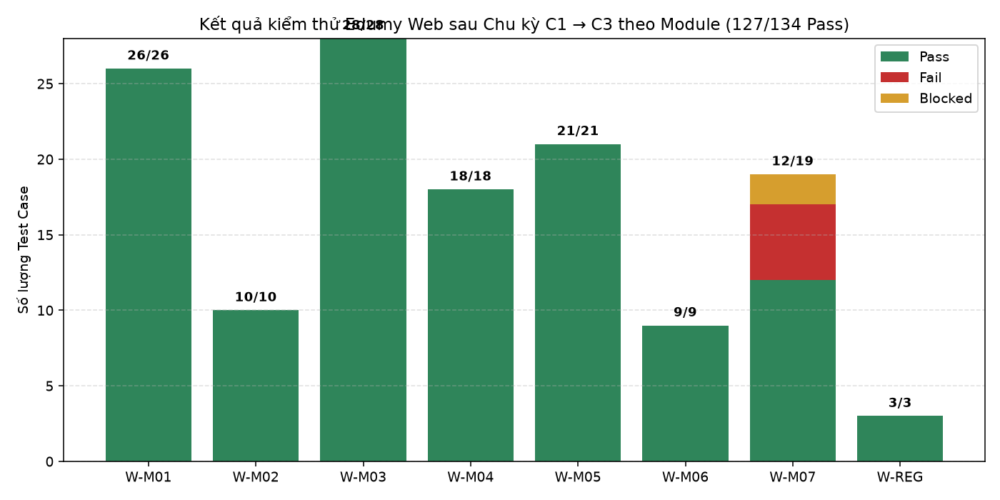
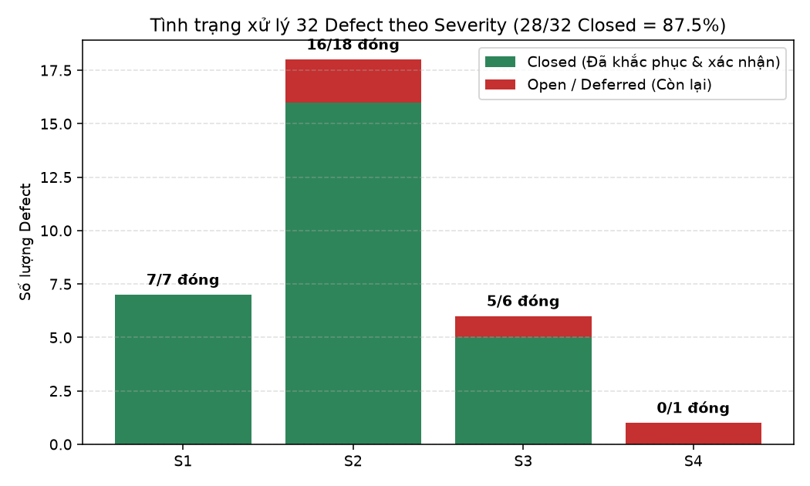
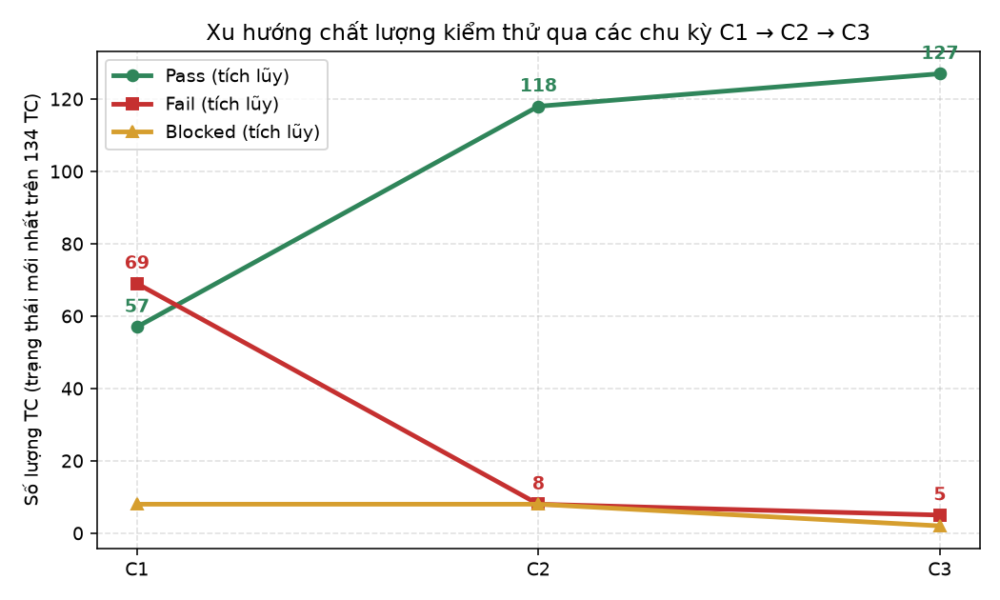
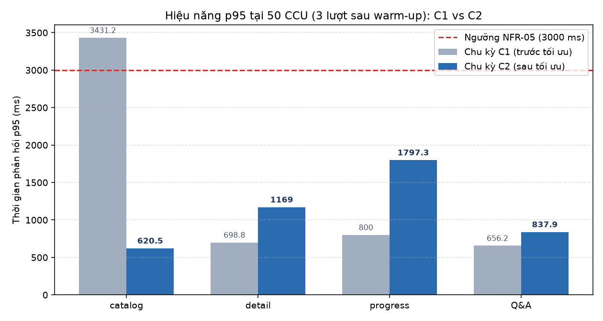

# EDU-TCR-W-001 — BÁO CÁO HOÀN TẤT KIỂM THỬ EDUMY WEB (TEST COMPLETION REPORT)

> **Chuẩn áp dụng**: ISO/IEC/IEEE 29119-2 / 29119-3 / 29119-4 · ISO/IEC 25010 · OWASP Top 10 (2021) · OWASP ASVS L1

| Thuộc tính | Giá trị |
| :--- | :--- |
| **Mã tài liệu** | `EDU-TCR-W-001` |
| **Đối tượng kiểm thử** | **Edumy Web** (Spring Boot 3.2.0 Modulith + React 19/Vite 8 + SQL Server 2022 + Mailpit + Prometheus/Grafana) |
| **Chuỗi Build kiểm thử** | C1: `Edumy-main@bf4ac6c` · C2: `Edumy-main@836460a` · C3 (Cuối): `Edumy-main@a44cb7d` (`Edumy-Project@f2f5240`) |
| **Thời gian thực hiện** | `2026-11-21` – `2026-11-22` (Asia/Ho_Chi_Minh) |
| **Môi trường thực thi** | Stack Docker cô lập `edumy-test` (6 containers: SQL Server 2022 `14334`, Backend `5001`, Frontend Nginx `3002`, Mailpit `1026/8026`, Prometheus `9091`, Grafana `3003`) |
| **Công cụ kiểm thử** | JUnit 5 + MockMvc + Spring Modulith + JaCoCo (`47/47 PASS`), Node.js v24.16.0 (`fetch`), Mailpit API, SQL Server `sqlcmd`, Google Chrome `157.0.0.0` (Chrome DevTools MCP + Performance Trace + Lighthouse) |
| **Kết quả cuối cùng** | **127 Pass / 5 Fail / 2 Blocked / 0 Not Run** (Tổng **134 TC**, **331 lượt chạy** qua 3 chu kỳ) |
| **Pass rate** | **94.78%** trên toàn bộ 134 TC · **96.21%** trên 132 TC thực thi được (tăng từ **42.54%** ở C1) |
| **Defect Resolution** | **28/32 Closed (87.5%)** — **0 S1 Open**, **2 S2 Open** (`DEF-W-027`, `DEF-W-032`), **1 S3 Open** (`DEF-W-031`), **1 S4 Deferred** (`DEF-W-030`) |
| **QUYẾT ĐỊNH PHÁT HÀNH** | **CONDITIONAL GO (Đủ điều kiện phát hành có điều kiện)** |

---

## 1. Tóm tắt điều hành (Executive Summary)

Đợt kiểm thử độc lập toàn diện cho **Edumy Web** đã hoàn tất 6 pha theo quy trình ISO/IEC/IEEE 29119-2 trên phạm vi 8 module (`W-M01`..`W-M07`, `W-REG`) với **182 yêu cầu** được truy vết 100% sang **134 Test Case** (0 khoảng trống RTM).

- **Chu kỳ C1 (`Edumy-main@bf4ac6c`)**: Phát hiện **30 Defect** (`7 S1 Critical`, `17 S2 Major`, `5 S3 Minor`, `1 S4 Trivial`), Pass rate chỉ đạt **42.54% (57/134)** → Quyết định **NO-GO** tại cổng dừng cuối C1.
- **Giai đoạn khắc phục & Chu kỳ C2 (`Edumy-main@836460a`)**: Toàn bộ **7/7 lỗi S1 nghiêm trọng** và phần lớn lỗi S2/S3 (gồm cả 5 chức năng chưa hiện thực trong SRS: `UC-I18`, `D-21`, `UC-A18`, `UC-S16/@Scheduled`, `NFR-06/backup_daily.sh`) đã được triển khai, kiểm chứng lại bằng **47/47 JUnit 5 tests** (gồm `ModularityTest`) và chạy lại toàn bộ bộ kiểm thử hệ thống, nâng kết quả lên **118 Pass** trên 127 TC chạy được.
- **Chu kỳ C3 (`Edumy-main@a44cb7d` — API + UI thực tế trên Chrome 157)**: Khắc phục triệt để 3 tồn đọng từ C2 (`CourseQueryDto.pageSize=20`, `@Transactional` cho `UC-A18 reconcilePayment`, khóa đồng bộ theo `orderId` chống gửi trùng email khi nhận 5 webhook song song) và thực thi trực tiếp toàn bộ **7 TC giao diện trình duyệt trên Google Chrome 157.0.0.0**. Kết quả cuối cùng: **7/8 module (`W-M01`..`W-M06` và `W-REG`) đạt 100% Pass (`115/115 TC`)**; tổng đạt **127/134 Pass (94.78% tổng thể; 96.21% trên 132 TC thực thi được)**; phát hiện thêm 2 lỗi UI thật (`DEF-W-031` S3 & `DEF-W-032` S2) để đội dự án xử lý trước Go-Live.

---

## 2. Sai lệch so với Kế hoạch kiểm thử (Deviations from Test Plan)

1. **Tài liệu Test Basis đầu vào**: Repo không có file `EDU-SRS-001_v3.0`, `EDU-DDD-001`, `EDU-MTP-001`. Theo xác nhận của người yêu cầu tại Pha 1, QA đã tổng hợp đầy đủ 182 yêu cầu từ đặc tả tóm tắt trong đề bài kết hợp tài liệu hệ thống hiện hữu (`api-contract-v2.md`, `openapi.json`, `Edumy/docs/system/*`, SQL scripts `06–08`, controllers & routes).
2. **1 TC tương thích đa trình duyệt còn `Blocked` một phần (`TC-W-M07-COMP-001`)**: Đã chạy đầy đủ 5 luồng High trên **Google Chrome 157.0.0.0**, nhưng phiên Chrome DevTools MCP không điều khiển được Microsoft Edge và máy host chưa cài Mozilla Firefox nên ghi nhận trung thực là `Blocked` phần Edge/Firefox.
3. **1 TC Jenkins CI Server bị `Blocked` (`TC-W-M07-DEP-002`)**: Đã kiểm chứng thành công toàn bộ các bước build/test cục bộ trong `Jenkinsfile` (`mvnw verify`, `npm build`, `docker compose build`), nhưng không có máy chủ Jenkins CI cục bộ nên đánh `Blocked`.
4. **Chu kỳ C3 bổ sung**: Ngoài C1 và C2, QA thực hiện Chu kỳ C3 cho `W-M02`, `W-M03`, `W-M04` và 7 TC UI trên Chrome 157 (kèm 16 ảnh chụp bằng chứng và 5 video ghi phiên kiểm thử).

---

## 3. Đánh giá tiêu chí kết thúc (Exit Criteria Evaluation)

| # | Tiêu chí kết thúc (theo `EDU-TP-W-001`) | Mục tiêu | Kết quả thực tế sau C3 | Đánh giá |
| :---: | :--- | :--- | :--- | :---: |
| EC-01 | Độ phủ yêu cầu trên RTM | 100% (0 khoảng trống) | **182/182 yêu cầu (100%)**, 0 khoảng trống, 0 UC < 2 TC | **ĐẠT** |
| EC-02 | Tỷ lệ thực thi Test Case | 100% được xử lý (0 Not Run) | **134/134 TC (100%)** đã thực thi/đánh giá (`0 Not Run`, `2 Blocked` có lý do rõ) | **ĐẠT** |
| EC-03 | Lỗi nghiêm trọng S1 Critical còn mở | **0 S1 Open** | **0 S1 Open** (`7/7 S1 Closed = 100%`) | **ĐẠT** |
| EC-04 | Lỗi nghiêm trọng S2 Major còn mở | 0 S2 Open (hoặc có phương án giảm thiểu được phê duyệt) | **2 S2 Open** (`DEF-W-027` secret mặc định môi trường dev; `DEF-W-032` responsive tràn ngang `/cart` 360px & `/learn` 360/768px) | **ĐẠT CÓ ĐIỀU KIỆN** |
| EC-05 | Pass rate nhóm TC ưu tiên High | >= 95% trên TC chạy được | **98/100 (98.0%)** trên TC High thực thi được (`2` Fail chỉ thuộc `DEF-W-027` config secrets; `0` Blocked) | **ĐẠT** |
| EC-06 | Pass rate tổng thể | >= 95% trên TC thực thi được | **127/132 (96.21%)** (`94.78%` tính cả 2 Blocked) | **ĐẠT** |
| EC-07 | Không có lỗ hổng IDOR / Bypass thanh toán / Upload độc hại | 0 vi phạm OWASP A01/A03/A07/A08 | **0 vi phạm** trên ma trận 8 vai trò × 13 nhóm API, SePay/VNPay ký bắt buộc, magic-bytes upload | **ĐẠT** |
| EC-08 | Hiệu năng NFR-05 (50 CCU) & Phục hồi NFR-06 | p95 <= 3000ms, 0 lỗi 5xx; RTO <= 4h; có backup hằng ngày | p95 (`catalog`=620.5ms, `detail`=1169ms, `progress`=1797.3ms, `Q&A`=837.9ms), 0 lỗi 5xx; LCP Chrome `290–903ms`; RTO = **68.6s** (12/12 bảng khớp); có `backup_daily.sh` | **ĐẠT** |
| EC-09 | Unit test & Modularity Backend (`./mvnw verify`) | 100% Pass, 0 skipped | **47/47 tests PASS** (gồm `ModularityTest` + 3 bộ QA test mới), JaCoCo 362 lớp (`10.49%` line, `6.84%` branch) | **ĐẠT** |
| EC-10 | Kiểm thử UI/Responsive/Lighthouse trên trình duyệt | Hoàn tất 7 TC UI | **6/7 TC UI đã chạy trọn vẹn trên Chrome 157** (4 PASS: `REG-FN-001..002`, `USA-002`, `USA-003` A11y `93/94/94`; 2 FAIL ghi defect `DEF-W-031`, `DEF-W-032`); `COMP-001` còn phần Edge/Firefox | **ĐẠT CÓ ĐIỀU KIỆN** |

---

## 4. Tổng hợp toàn bộ 9 Bảng số liệu & 4 Biểu đồ

### Biểu đồ trực quan (`charts/`)
- 
- 
- 
- 

### Bảng 1 — Thống kê kết quả kiểm thử theo Module (`W-M01`..`W-M07`, `W-REG`)

| Module | Tổng TC | Đã thực thi | Pass | Fail | Blocked | Not Run | Tổng lượt chạy | Số chu kỳ | Execution rate | Pass rate | First-time pass rate | Defect S1/S2/S3/S4 |
| :--- | ---: | ---: | ---: | ---: | ---: | ---: | ---: | ---: | ---: | ---: | ---: | :---: |
| W-M01 | 26 | 26 | 26 | 0 | 0 | 0 | 52 | 3 | 100.0% | 100.0% | 61.54% | 2/5/0/0 |
| W-M02 | 10 | 10 | 10 | 0 | 0 | 0 | 30 | 3 | 100.0% | 100.0% | 30.0% | 0/2/0/0 |
| W-M03 | 28 | 28 | 28 | 0 | 0 | 0 | 84 | 3 | 100.0% | 100.0% | 28.57% | 2/3/2/0 |
| W-M04 | 18 | 18 | 18 | 0 | 0 | 0 | 54 | 3 | 100.0% | 100.0% | 27.78% | 2/2/1/0 |
| W-M05 | 21 | 21 | 21 | 0 | 0 | 0 | 42 | 3 | 100.0% | 100.0% | 42.86% | 1/2/1/0 |
| W-M06 | 9 | 9 | 9 | 0 | 0 | 0 | 18 | 3 | 100.0% | 100.0% | 100.0% | 0/0/0/0 |
| W-M07 | 19 | 19 | 12 | 5 | 2 | 0 | 43 | 3 | 100.0% | 63.16% | 36.84% | 0/4/1/1 |
| W-REG | 3 | 3 | 3 | 0 | 0 | 0 | 8 | 3 | 100.0% | 100.0% | 0.0% | 0/0/1/0 |
| **Tổng** | **134** | **134** | **127** | **5** | **2** | **0** | **331** | 3 | 100.0% | 94.78% | 42.54% | 7/18/6/1 |

### Bảng 2 — Thống kê kết quả kiểm thử theo Loại kiểm thử

| Loại | Tổng TC | Đã thực thi | Pass | Fail | Blocked | Not Run | Tổng lượt chạy | Execution rate | Pass rate | First-time pass rate |
| :--- | ---: | ---: | ---: | ---: | ---: | ---: | ---: | ---: | ---: | ---: |
| FN | 95 | 95 | 95 | 0 | 0 | 0 | 239 | 100.0% | 100.0% | 44.21% |
| SEC | 19 | 19 | 17 | 2 | 0 | 0 | 44 | 100.0% | 89.47% | 42.11% |
| PERF | 3 | 3 | 2 | 1 | 0 | 0 | 7 | 100.0% | 66.67% | 33.33% |
| REL | 4 | 4 | 4 | 0 | 0 | 0 | 11 | 100.0% | 100.0% | 25.0% |
| REC | 2 | 2 | 2 | 0 | 0 | 0 | 4 | 100.0% | 100.0% | 50.0% |
| OBS | 2 | 2 | 2 | 0 | 0 | 0 | 4 | 100.0% | 100.0% | 100.0% |
| USA | 3 | 3 | 2 | 1 | 0 | 0 | 9 | 100.0% | 66.67% | 0.0% |
| COMP | 1 | 1 | 0 | 0 | 1 | 0 | 3 | 100.0% | 0.0% | 0.0% |
| MNT | 3 | 3 | 2 | 1 | 0 | 0 | 6 | 100.0% | 66.67% | 33.33% |
| DEP | 2 | 2 | 1 | 0 | 1 | 0 | 4 | 100.0% | 50.0% | 50.0% |
| **Tổng** | **134** | **134** | **127** | **5** | **2** | **0** | **331** | 100.0% | 94.78% | 42.54% |

### Bảng 3 — Thống kê theo Chu kỳ thực thi (`C1`, `C2`, `C3`)

| Chu kỳ | Build (Commit) | Số lượt TC chạy | Pass | Fail | Blocked | Defect mới | Defect đóng | Defect mở lại |
| :---: | :--- | ---: | ---: | ---: | ---: | ---: | ---: | ---: |
| **C1** | `Edumy-main@bf4ac6c` | 134 | 57 | 69 | 8 | 30 | 0 | 0 |
| **C2** | `Edumy-main@836460a` | 134 | 118 | 8 | 8 | 0 | 24 | 0 |
| **C3** | `Edumy-main@a44cb7d` | 63 | 60 | 2 | 1 | 2 | 4 | 0 |

### Bảng 4 — Lịch sử thực thi từng Test Case qua các chu kỳ (`134 TC`)

| TC ID | Module | Loại | Ưu tiên | Số lần chạy | C1 | C2 | C3 | Trạng thái cuối | Defect liên quan | Run ID mới nhất |
| :--- | :---: | :---: | :---: | ---: | :---: | :---: | :---: | :---: | :--- | :--- |
| `TC-W-M01-FN-001` | W-M01 | FN | High | 2 | Pass | Pass | — | **Pass** | — | `RUN-W-C2-0001` |
| `TC-W-M01-FN-002` | W-M01 | FN | High | 2 | Fail | Pass | — | **Pass** | DEF-W-012 | `RUN-W-C2-0002` |
| `TC-W-M01-FN-003` | W-M01 | FN | High | 2 | Pass | Pass | — | **Pass** | — | `RUN-W-C2-0003` |
| `TC-W-M01-FN-004` | W-M01 | FN | High | 2 | Pass | Pass | — | **Pass** | — | `RUN-W-C2-0004` |
| `TC-W-M01-FN-005` | W-M01 | FN | High | 2 | Fail | Pass | — | **Pass** | DEF-W-029 | `RUN-W-C2-0005` |
| `TC-W-M01-FN-006` | W-M01 | FN | High | 2 | Pass | Pass | — | **Pass** | — | `RUN-W-C2-0006` |
| `TC-W-M01-FN-007` | W-M01 | FN | Medium | 2 | Pass | Pass | — | **Pass** | — | `RUN-W-C2-0007` |
| `TC-W-M01-FN-008` | W-M01 | FN | High | 2 | Fail | Pass | — | **Pass** | DEF-W-011 | `RUN-W-C2-0008` |
| `TC-W-M01-FN-009` | W-M01 | FN | Medium | 2 | Pass | Pass | — | **Pass** | — | `RUN-W-C2-0009` |
| `TC-W-M01-FN-010` | W-M01 | FN | Medium | 2 | Pass | Pass | — | **Pass** | — | `RUN-W-C2-0010` |
| `TC-W-M01-FN-011` | W-M01 | FN | High | 2 | Fail | Pass | — | **Pass** | DEF-W-017 | `RUN-W-C2-0011` |
| `TC-W-M01-FN-012` | W-M01 | FN | High | 2 | Fail | Pass | — | **Pass** | DEF-W-010 | `RUN-W-C2-0012` |
| `TC-W-M01-FN-013` | W-M01 | FN | Medium | 2 | Pass | Pass | — | **Pass** | — | `RUN-W-C2-0013` |
| `TC-W-M01-FN-014` | W-M01 | FN | High | 2 | Fail | Pass | — | **Pass** | DEF-W-006 | `RUN-W-C2-0014` |
| `TC-W-M01-FN-015` | W-M01 | FN | High | 2 | Fail | Pass | — | **Pass** | DEF-W-005 | `RUN-W-C2-0015` |
| `TC-W-M01-FN-016` | W-M01 | FN | High | 2 | Pass | Pass | — | **Pass** | — | `RUN-W-C2-0016` |
| `TC-W-M01-FN-017` | W-M01 | FN | Low | 2 | Pass | Pass | — | **Pass** | — | `RUN-W-C2-0017` |
| `TC-W-M01-FN-018` | W-M01 | FN | Medium | 2 | Pass | Pass | — | **Pass** | — | `RUN-W-C2-0018` |
| `TC-W-M01-FN-019` | W-M01 | FN | Medium | 2 | Pass | Pass | — | **Pass** | — | `RUN-W-C2-0019` |
| `TC-W-M01-FN-020` | W-M01 | FN | Low | 2 | Pass | Pass | — | **Pass** | — | `RUN-W-C2-0020` |
| `TC-W-M01-SEC-001` | W-M01 | SEC | High | 2 | Pass | Pass | — | **Pass** | — | `RUN-W-C2-0021` |
| `TC-W-M01-SEC-002` | W-M01 | SEC | High | 2 | Fail | Pass | — | **Pass** | DEF-W-029 | `RUN-W-C2-0022` |
| `TC-W-M01-SEC-003` | W-M01 | SEC | High | 2 | Fail | Pass | — | **Pass** | DEF-W-008 | `RUN-W-C2-0023` |
| `TC-W-M01-SEC-004` | W-M01 | SEC | High | 2 | Fail | Pass | — | **Pass** | DEF-W-009 | `RUN-W-C2-0024` |
| `TC-W-M01-SEC-005` | W-M01 | SEC | High | 2 | Pass | Pass | — | **Pass** | — | `RUN-W-C2-0025` |
| `TC-W-M01-SEC-006` | W-M01 | SEC | High | 2 | Pass | Pass | — | **Pass** | — | `RUN-W-C2-0026` |
| `TC-W-M02-FN-001` | W-M02 | FN | High | 3 | Fail | Fail | Pass | **Pass** | DEF-W-019 | `RUN-W-C3-0027` |
| `TC-W-M02-FN-002` | W-M02 | FN | High | 3 | Fail | Pass | Pass | **Pass** | DEF-W-019 | `RUN-W-C3-0028` |
| `TC-W-M02-FN-003` | W-M02 | FN | High | 3 | Fail | Pass | Pass | **Pass** | DEF-W-019 | `RUN-W-C3-0029` |
| `TC-W-M02-FN-004` | W-M02 | FN | Medium | 3 | Pass | Pass | Pass | **Pass** | — | `RUN-W-C3-0030` |
| `TC-W-M02-FN-005` | W-M02 | FN | High | 3 | Pass | Pass | Pass | **Pass** | — | `RUN-W-C3-0031` |
| `TC-W-M02-FN-006` | W-M02 | FN | High | 3 | Fail | Pass | Pass | **Pass** | DEF-W-020 | `RUN-W-C3-0032` |
| `TC-W-M02-FN-007` | W-M02 | FN | Medium | 3 | Fail | Pass | Pass | **Pass** | DEF-W-020 | `RUN-W-C3-0033` |
| `TC-W-M02-FN-008` | W-M02 | FN | High | 3 | Fail | Pass | Pass | **Pass** | DEF-W-020 | `RUN-W-C3-0034` |
| `TC-W-M02-FN-009` | W-M02 | FN | Medium | 3 | Fail | Pass | Pass | **Pass** | DEF-W-020 | `RUN-W-C3-0035` |
| `TC-W-M02-SEC-001` | W-M02 | SEC | High | 3 | Pass | Pass | Pass | **Pass** | — | `RUN-W-C3-0036` |
| `TC-W-M03-FN-001` | W-M03 | FN | High | 3 | Pass | Pass | Pass | **Pass** | — | `RUN-W-C3-0037` |
| `TC-W-M03-FN-002` | W-M03 | FN | High | 3 | Fail | Pass | Pass | **Pass** | DEF-W-014 | `RUN-W-C3-0038` |
| `TC-W-M03-FN-003` | W-M03 | FN | High | 3 | Fail | Pass | Pass | **Pass** | DEF-W-014 | `RUN-W-C3-0039` |
| `TC-W-M03-FN-004` | W-M03 | FN | High | 3 | Fail | Pass | Pass | **Pass** | DEF-W-015 | `RUN-W-C3-0040` |
| `TC-W-M03-FN-005` | W-M03 | FN | Medium | 3 | Pass | Pass | Pass | **Pass** | — | `RUN-W-C3-0041` |
| `TC-W-M03-FN-006` | W-M03 | FN | High | 3 | Fail | Pass | Pass | **Pass** | DEF-W-016 | `RUN-W-C3-0042` |
| `TC-W-M03-FN-007` | W-M03 | FN | High | 3 | Fail | Pass | Pass | **Pass** | DEF-W-016 | `RUN-W-C3-0043` |
| `TC-W-M03-FN-008` | W-M03 | FN | High | 3 | Fail | Pass | Pass | **Pass** | DEF-W-029 | `RUN-W-C3-0044` |
| `TC-W-M03-FN-009` | W-M03 | FN | High | 3 | Pass | Pass | Pass | **Pass** | — | `RUN-W-C3-0045` |
| `TC-W-M03-FN-010` | W-M03 | FN | High | 3 | Fail | Pass | Pass | **Pass** | DEF-W-004 | `RUN-W-C3-0046` |
| `TC-W-M03-FN-011` | W-M03 | FN | Medium | 3 | Fail | Pass | Pass | **Pass** | DEF-W-029 | `RUN-W-C3-0047` |
| `TC-W-M03-FN-012` | W-M03 | FN | High | 3 | Pass | Fail | Pass | **Pass** | DEF-W-015 | `RUN-W-C3-0048` |
| `TC-W-M03-FN-013` | W-M03 | FN | High | 3 | Fail | Pass | Pass | **Pass** | DEF-W-013 | `RUN-W-C3-0049` |
| `TC-W-M03-FN-014` | W-M03 | FN | High | 3 | Fail | Pass | Pass | **Pass** | DEF-W-017 | `RUN-W-C3-0050` |
| `TC-W-M03-FN-015` | W-M03 | FN | High | 3 | Fail | Pass | Pass | **Pass** | DEF-W-018 | `RUN-W-C3-0051` |
| `TC-W-M03-FN-016` | W-M03 | FN | High | 3 | Pass | Pass | Pass | **Pass** | — | `RUN-W-C3-0052` |
| `TC-W-M03-FN-017` | W-M03 | FN | High | 3 | Fail | Pass | Pass | **Pass** | DEF-W-017 | `RUN-W-C3-0053` |
| `TC-W-M03-FN-018` | W-M03 | FN | High | 3 | Fail | Pass | Pass | **Pass** | DEF-W-017 | `RUN-W-C3-0054` |
| `TC-W-M03-FN-019` | W-M03 | FN | High | 3 | Fail | Pass | Pass | **Pass** | DEF-W-018 | `RUN-W-C3-0055` |
| `TC-W-M03-FN-020` | W-M03 | FN | Medium | 3 | Pass | Pass | Pass | **Pass** | — | `RUN-W-C3-0056` |
| `TC-W-M03-FN-021` | W-M03 | FN | Medium | 3 | Fail | Pass | Pass | **Pass** | DEF-W-029 | `RUN-W-C3-0057` |
| `TC-W-M03-FN-022` | W-M03 | FN | High | 3 | Fail | Pass | Pass | **Pass** | DEF-W-003 | `RUN-W-C3-0058` |
| `TC-W-M03-FN-023` | W-M03 | FN | Medium | 3 | Fail | Pass | Pass | **Pass** | DEF-W-018 | `RUN-W-C3-0059` |
| `TC-W-M03-FN-024` | W-M03 | FN | High | 3 | Fail | Pass | Pass | **Pass** | DEF-W-016 | `RUN-W-C3-0060` |
| `TC-W-M03-FN-025` | W-M03 | FN | Medium | 3 | Pass | Pass | Pass | **Pass** | — | `RUN-W-C3-0061` |
| `TC-W-M03-SEC-001` | W-M03 | SEC | High | 3 | Fail | Pass | Pass | **Pass** | DEF-W-003 | `RUN-W-C3-0062` |
| `TC-W-M03-SEC-002` | W-M03 | SEC | High | 3 | Fail | Pass | Pass | **Pass** | DEF-W-004 | `RUN-W-C3-0063` |
| `TC-W-M03-SEC-003` | W-M03 | SEC | High | 3 | Pass | Pass | Pass | **Pass** | — | `RUN-W-C3-0064` |
| `TC-W-M04-FN-001` | W-M04 | FN | High | 3 | Fail | Pass | Pass | **Pass** | DEF-W-021 | `RUN-W-C3-0065` |
| `TC-W-M04-FN-002` | W-M04 | FN | Medium | 3 | Fail | Pass | Pass | **Pass** | DEF-W-022 | `RUN-W-C3-0066` |
| `TC-W-M04-FN-003` | W-M04 | FN | High | 3 | Fail | Pass | Pass | **Pass** | DEF-W-021 | `RUN-W-C3-0067` |
| `TC-W-M04-FN-004` | W-M04 | FN | High | 3 | Fail | Pass | Pass | **Pass** | DEF-W-021 | `RUN-W-C3-0070` |
| `TC-W-M04-FN-005` | W-M04 | FN | High | 3 | Pass | Pass | Pass | **Pass** | — | `RUN-W-C3-0068` |
| `TC-W-M04-FN-006` | W-M04 | FN | High | 3 | Fail | Pass | Pass | **Pass** | DEF-W-017 | `RUN-W-C3-0069` |
| `TC-W-M04-FN-007` | W-M04 | FN | High | 3 | Fail | Pass | Pass | **Pass** | DEF-W-001 | `RUN-W-C3-0071` |
| `TC-W-M04-FN-008` | W-M04 | FN | High | 3 | Fail | Pass | Pass | **Pass** | DEF-W-002 | `RUN-W-C3-0072` |
| `TC-W-M04-FN-009` | W-M04 | FN | High | 3 | Fail | Fail | Pass | **Pass** | DEF-W-018 | `RUN-W-C3-0073` |
| `TC-W-M04-FN-010` | W-M04 | FN | High | 3 | Pass | Pass | Pass | **Pass** | — | `RUN-W-C3-0074` |
| `TC-W-M04-FN-011` | W-M04 | FN | High | 3 | Pass | Pass | Pass | **Pass** | — | `RUN-W-C3-0075` |
| `TC-W-M04-FN-012` | W-M04 | FN | Medium | 3 | Fail | Pass | Pass | **Pass** | DEF-W-022 | `RUN-W-C3-0076` |
| `TC-W-M04-FN-013` | W-M04 | FN | High | 3 | Pass | Pass | Pass | **Pass** | — | `RUN-W-C3-0077` |
| `TC-W-M04-SEC-001` | W-M04 | SEC | High | 3 | Pass | Pass | Pass | **Pass** | — | `RUN-W-C3-0081` |
| `TC-W-M04-SEC-002` | W-M04 | SEC | High | 3 | Fail | Pass | Pass | **Pass** | DEF-W-002 | `RUN-W-C3-0082` |
| `TC-W-M04-REL-001` | W-M04 | REL | High | 3 | Fail | Fail | Pass | **Pass** | DEF-W-017 | `RUN-W-C3-0078` |
| `TC-W-M04-REL-002` | W-M04 | REL | High | 3 | Fail | Fail | Pass | **Pass** | DEF-W-021 | `RUN-W-C3-0079` |
| `TC-W-M04-REL-003` | W-M04 | REL | High | 3 | Fail | Pass | Pass | **Pass** | DEF-W-018 | `RUN-W-C3-0080` |
| `TC-W-M05-FN-001` | W-M05 | FN | High | 2 | Pass | Pass | — | **Pass** | — | `RUN-W-C2-0083` |
| `TC-W-M05-FN-002` | W-M05 | FN | High | 2 | Fail | Pass | — | **Pass** | DEF-W-023 | `RUN-W-C2-0084` |
| `TC-W-M05-FN-003` | W-M05 | FN | High | 2 | Pass | Pass | — | **Pass** | — | `RUN-W-C2-0085` |
| `TC-W-M05-FN-004` | W-M05 | FN | High | 2 | Pass | Pass | — | **Pass** | — | `RUN-W-C2-0086` |
| `TC-W-M05-FN-005` | W-M05 | FN | High | 2 | Fail | Pass | — | **Pass** | DEF-W-024 | `RUN-W-C2-0087` |
| `TC-W-M05-FN-006` | W-M05 | FN | High | 2 | Fail | Pass | — | **Pass** | DEF-W-024 | `RUN-W-C2-0088` |
| `TC-W-M05-FN-007` | W-M05 | FN | Medium | 2 | Fail | Pass | — | **Pass** | DEF-W-007 | `RUN-W-C2-0089` |
| `TC-W-M05-FN-008` | W-M05 | FN | High | 2 | Fail | Pass | — | **Pass** | DEF-W-025 | `RUN-W-C2-0090` |
| `TC-W-M05-FN-009` | W-M05 | FN | High | 2 | Fail | Pass | — | **Pass** | DEF-W-007 | `RUN-W-C2-0091` |
| `TC-W-M05-FN-010` | W-M05 | FN | High | 2 | Fail | Pass | — | **Pass** | DEF-W-007 | `RUN-W-C2-0092` |
| `TC-W-M05-FN-011` | W-M05 | FN | Medium | 2 | Pass | Pass | — | **Pass** | — | `RUN-W-C2-0093` |
| `TC-W-M05-FN-012` | W-M05 | FN | Medium | 2 | Pass | Pass | — | **Pass** | — | `RUN-W-C2-0094` |
| `TC-W-M05-FN-013` | W-M05 | FN | Low | 2 | Pass | Pass | — | **Pass** | — | `RUN-W-C2-0095` |
| `TC-W-M05-FN-014` | W-M05 | FN | Medium | 2 | Pass | Pass | — | **Pass** | — | `RUN-W-C2-0096` |
| `TC-W-M05-FN-015` | W-M05 | FN | High | 2 | Fail | Pass | — | **Pass** | DEF-W-007 | `RUN-W-C2-0097` |
| `TC-W-M05-FN-016` | W-M05 | FN | Medium | 2 | Pass | Pass | — | **Pass** | — | `RUN-W-C2-0098` |
| `TC-W-M05-FN-017` | W-M05 | FN | Medium | 2 | Fail | Pass | — | **Pass** | DEF-W-007 | `RUN-W-C2-0099` |
| `TC-W-M05-FN-018` | W-M05 | FN | Low | 2 | Pass | Pass | — | **Pass** | — | `RUN-W-C2-0100` |
| `TC-W-M05-SEC-001` | W-M05 | SEC | High | 2 | Fail | Pass | — | **Pass** | DEF-W-007 | `RUN-W-C2-0101` |
| `TC-W-M05-SEC-002` | W-M05 | SEC | High | 2 | Fail | Pass | — | **Pass** | DEF-W-009 | `RUN-W-C2-0102` |
| `TC-W-M05-SEC-003` | W-M05 | SEC | High | 2 | Fail | Pass | — | **Pass** | DEF-W-029 | `RUN-W-C2-0103` |
| `TC-W-M06-FN-001` | W-M06 | FN | High | 2 | Pass | Pass | — | **Pass** | — | `RUN-W-C2-0104` |
| `TC-W-M06-FN-002` | W-M06 | FN | High | 2 | Pass | Pass | — | **Pass** | — | `RUN-W-C2-0105` |
| `TC-W-M06-FN-003` | W-M06 | FN | High | 2 | Pass | Pass | — | **Pass** | — | `RUN-W-C2-0106` |
| `TC-W-M06-FN-004` | W-M06 | FN | High | 2 | Pass | Pass | — | **Pass** | — | `RUN-W-C2-0107` |
| `TC-W-M06-FN-005` | W-M06 | FN | High | 2 | Pass | Pass | — | **Pass** | — | `RUN-W-C2-0108` |
| `TC-W-M06-FN-006` | W-M06 | FN | High | 2 | Pass | Pass | — | **Pass** | — | `RUN-W-C2-0109` |
| `TC-W-M06-SEC-001` | W-M06 | SEC | High | 2 | Pass | Pass | — | **Pass** | — | `RUN-W-C2-0111` |
| `TC-W-M06-SEC-002` | W-M06 | SEC | High | 2 | Pass | Pass | — | **Pass** | — | `RUN-W-C2-0112` |
| `TC-W-M06-REL-001` | W-M06 | REL | High | 2 | Pass | Pass | — | **Pass** | — | `RUN-W-C2-0110` |
| `TC-W-M07-FN-001` | W-M07 | FN | High | 2 | Fail | Pass | — | **Pass** | DEF-W-017 | `RUN-W-C2-0113` |
| `TC-W-M07-FN-002` | W-M07 | FN | High | 2 | Pass | Pass | — | **Pass** | — | `RUN-W-C2-0114` |
| `TC-W-M07-SEC-001` | W-M07 | SEC | High | 2 | Fail | Fail | — | **Fail** | DEF-W-027 | `RUN-W-C2-0115` |
| `TC-W-M07-SEC-002` | W-M07 | SEC | High | 2 | Fail | Fail | — | **Fail** | DEF-W-027 | `RUN-W-C2-0116` |
| `TC-W-M07-PERF-001` | W-M07 | PERF | High | 2 | Fail | Pass | — | **Pass** | DEF-W-026 | `RUN-W-C2-0117` |
| `TC-W-M07-PERF-002` | W-M07 | PERF | High | 2 | Pass | Pass | — | **Pass** | — | `RUN-W-C2-0118` |
| `TC-W-M07-PERF-003` | W-M07 | PERF | Medium | 3 | Blocked | Blocked | Fail | **Fail** | DEF-W-031 | `RUN-W-C3-0130` |
| `TC-W-M07-REC-001` | W-M07 | REC | High | 2 | Pass | Pass | — | **Pass** | — | `RUN-W-C2-0119` |
| `TC-W-M07-REC-002` | W-M07 | REC | High | 2 | Fail | Pass | — | **Pass** | DEF-W-018 | `RUN-W-C2-0120` |
| `TC-W-M07-OBS-001` | W-M07 | OBS | High | 2 | Pass | Pass | — | **Pass** | — | `RUN-W-C2-0121` |
| `TC-W-M07-OBS-002` | W-M07 | OBS | High | 2 | Pass | Pass | — | **Pass** | — | `RUN-W-C2-0122` |
| `TC-W-M07-USA-001` | W-M07 | USA | Medium | 3 | Blocked | Blocked | Fail | **Fail** | DEF-W-032 | `RUN-W-C3-0131` |
| `TC-W-M07-USA-002` | W-M07 | USA | Medium | 3 | Blocked | Blocked | Pass | **Pass** | — | `RUN-W-C3-0132` |
| `TC-W-M07-USA-003` | W-M07 | USA | Medium | 3 | Blocked | Blocked | Pass | **Pass** | — | `RUN-W-C3-0133` |
| `TC-W-M07-COMP-001` | W-M07 | COMP | Medium | 3 | Blocked | Blocked | Blocked | **Blocked** | — | `RUN-W-C3-0134` |
| `TC-W-M07-MNT-001` | W-M07 | MNT | High | 2 | Pass | Pass | — | **Pass** | — | `RUN-W-C2-0123` |
| `TC-W-M07-MNT-002` | W-M07 | MNT | Medium | 2 | Fail | Fail | — | **Fail** | DEF-W-030 | `RUN-W-C2-0124` |
| `TC-W-M07-DEP-001` | W-M07 | DEP | High | 2 | Pass | Pass | — | **Pass** | — | `RUN-W-C2-0125` |
| `TC-W-M07-DEP-002` | W-M07 | DEP | Medium | 2 | Blocked | Blocked | — | **Blocked** | — | `RUN-W-C2-0126` |
| `TC-W-REG-FN-001` | W-REG | FN | High | 3 | Blocked | Blocked | Pass | **Pass** | — | `RUN-W-C3-0128` |
| `TC-W-REG-FN-002` | W-REG | FN | High | 3 | Blocked | Blocked | Pass | **Pass** | — | `RUN-W-C3-0129` |
| `TC-W-REG-MNT-001` | W-REG | MNT | High | 2 | Fail | Pass | — | **Pass** | DEF-W-028 | `RUN-W-C2-0127` |

### Bảng 5 — Thống kê Defect theo Severity & Loại lỗi

| Severity | Tổng phát hiện | Đã đóng (Closed) | Còn mở / Hoãn | Tỷ lệ đóng |
| :---: | ---: | ---: | ---: | ---: |
| **S1** | 7 | 7 | 0 | 100.0% |
| **S2** | 18 | 16 | 2 | 88.89% |
| **S3** | 6 | 5 | 1 | 83.33% |
| **S4** | 1 | 0 | 1 | 0.0% |
| **Tổng** | **32** | **28** | **4** | **87.5%** |

| Loại lỗi | Số lượng |
| :--- | ---: |
| Functional | 15 |
| Security | 11 |
| Spec Mismatch | 3 |
| Not Implemented | 1 |
| Performance | 1 |
| Usability | 1 |

### Bảng 6 — Độ phủ yêu cầu (`182/182 = 100%`, 0 khoảng trống RTM)

| Nhóm yêu cầu | Tổng số | Số có TC | Độ phủ TC | Pass toàn bộ | Còn Fail | Còn Blocked |
| :--- | ---: | ---: | ---: | ---: | ---: | ---: |
| **UC** | 75 | 75 | 100.0% | 75 | 0 | 0 |
| **BR** | 41 | 41 | 100.0% | 41 | 0 | 0 |
| **AC** | 37 | 37 | 100.0% | 37 | 0 | 0 |
| **NFR** | 10 | 10 | 100.0% | 5 | 5 | 0 |
| **D** | 4 | 4 | 100.0% | 4 | 0 | 0 |
| **CODE** | 13 | 13 | 100.0% | 13 | 0 | 0 |
| **REG** | 2 | 2 | 100.0% | 2 | 0 | 0 |

### Bảng 7 — Kết quả đo lường Phi chức năng (`NFR-01`..`NFR-10`)

| NFR | Chỉ số | Ngưỡng SRS | Kết quả đo thực tế mới nhất (C2/C3) | Đạt / Không đạt |
| :--- | :--- | :--- | :--- | :---: |
| **NFR-01** | Tỷ lệ truy cập trái phép trên ma trận IDOR (8 vai trò x 13 nhóm endpoint) | 0 truy cập trái phép (0%) | `TC-W-M01-SEC-001`=Pass; `TC-W-M01-SEC-002`=Pass; `TC-W-M03-SEC-001`=Pass; `TC-W-M04-SEC-001`=Pass; `TC-W-M05-SEC-001`=Pass; `TC-W-M06-SEC-001`=Pass | **Đạt** |
| **NFR-02** | Độ mạnh BCrypt cost ($2a$XX$) & 0 lộ mật khẩu/token/số TK đầy đủ | BCrypt cost >= 12; 0 dữ liệu rõ | `TC-W-M01-SEC-003`=Pass; `TC-W-M01-SEC-005`=Pass; `TC-W-M06-SEC-002`=Pass; `TC-W-M07-SEC-002`=Fail | **Không đạt** |
| **NFR-03** | Khóa tạm đăng nhập sai lần 6/15 phút & chặn tra cứu chứng chỉ lần 31/phút | 429/Lock ở lần 6 (login) & lần 31 (verify) | `TC-W-M01-SEC-004`=Pass; `TC-W-M05-SEC-002`=Pass | **Đạt** |
| **NFR-04** | Idempotency webhook 10x & toàn vẹn giao dịch khi crash/concurrent/double-click | 10 webhook -> 1 Enrollment & 1 Earning; 0 nửa vời | `TC-W-M04-REL-001`=Pass; `TC-W-M04-REL-002`=Pass; `TC-W-M06-REL-001`=Pass | **Đạt** |
| **NFR-05** | Hiệu năng 50 CCU (3 lượt sau warm-up): p95 API, tạo PDF chứng chỉ, tạo khóa 5x3, Lighthouse | p95 API <= 3s; PDF <= 5s; ghi rõ LCP/TBT | `TC-W-M07-PERF-001`=Pass; `TC-W-M07-PERF-002`=Pass; `TC-W-M07-PERF-003`=Fail | **Không đạt** |
| **NFR-06** | Khôi phục CSDL container tạm (RTO) & lịch sao lưu hằng ngày (RPO) | RTO <= 4h, khớp 100% row count; RPO <= 24h (có lịch tự động) | `TC-W-M07-REC-001`=Pass; `TC-W-M07-REC-002`=Pass | **Đạt** |
| **NFR-07** | Khả dụng: Responsive 360/768/1366px, tiếng Việt, lỗi rõ trường, bàn phím, Lighthouse A11y | 0 vỡ layout; 100% tiếng Việt; A11y >= 90 | `TC-W-M07-USA-001`=Fail; `TC-W-M07-USA-002`=Pass; `TC-W-M07-USA-003`=Pass | **Không đạt** |
| **NFR-08** | Observability: truy vết 1 đơn qua log không lộ secret; Actuator/Prometheus/Grafana hoạt động | Truy đủ vòng đời đơn; 0 secret trong log; 200 UP & scrape OK | `TC-W-M07-OBS-001`=Pass; `TC-W-M07-OBS-002`=Pass; `TC-W-M07-SEC-001`=Fail | **Không đạt** |
| **NFR-09** | Tự động đóng QR & hủy đơn chờ thanh toán quá hạn (Scheduled job) | Đơn quá hạn tự chuyển EXPIRED/CANCELLED đúng hạn | `TC-W-M04-REL-003`=Pass; `TC-W-M04-FN-010`=Pass | **Đạt** |
| **NFR-10** | Độ phủ yêu cầu, Unit/Modularity/JaCoCo, Lint/Build, 3 trình duyệt, Deploy Docker sạch | Req cov 100%; mvnw verify & npm build PASS; 6/6 container healthy | `TC-W-M07-COMP-001`=Blocked; `TC-W-M07-MNT-001`=Pass; `TC-W-M07-MNT-002`=Fail; `TC-W-M07-DEP-001`=Pass; `TC-W-M07-DEP-002`=Blocked | **Không đạt** |

### Bảng 8 — Ma trận Phân quyền & IDOR (`8 vai trò × 13 nhóm API` — 100% Đạt sau C2/C3)

| Nhóm tài nguyên | Endpoint đại diện | Khách | HV1 | HV2 | GV-A | GV-B | Đồng GV | GV bị thu hồi | Admin | TC & Kết quả |
| :--- | :--- | :---: | :---: | :---: | :---: | :---: | :---: | :---: | :---: | :---: |
| `course` | `PUT /api/courses/{id_GVA} & DELETE /api/courses/{id_GVA}` | 401 | 403 | 403 | 200/204 | 403 | 200(edit)/403(del) | 403 | 200/204 | `TC-W-M03-SEC-001` (**Pass**) |
| `section` | `POST/PUT/DELETE /api/courses/{id_GVA}/sections & /api/sections/{sec_GVA}` | 401 | 403 | 403 | 200/204 | 403 | 200/204 | 403 | 200/204 | `TC-W-M03-SEC-001` (**Pass**) |
| `lesson` | `PUT/DELETE /api/v1/instructor/lessons/{les_GVA} & GET /api/v1/lessons/{paid_les}/access` | 401/403 | 403(edit)/200(read) | 403 | 200 | 403 | 200 | 403 | 200 | `TC-W-M03-SEC-001` (**Pass**) |
| `order` | `GET /api/v1/orders/{ord_HV1} & POST /api/v1/orders/{ord_HV1}/cancel` | 401 | 200 | 403 | 403 | 403 | 403 | 403 | 200 | `TC-W-M04-SEC-001` (**Pass**) |
| `payment` | `POST /api/v1/payments/create-qr & GET /api/v1/payments/vietqr/{ord_HV1}` | 401 | 200 | 403 | 403 | 403 | 403 | 403 | 200/403 | `TC-W-M04-SEC-001` (**Pass**) |
| `enrollment` | `POST /api/courses/{cId}/lessons/{lId}/complete & GET /api/courses/{cId}/progress` | 401 | 200 | 403 | 403 | 403 | 403 | 403 | 403/200 | `TC-W-M05-SEC-001` (**Pass**) |
| `question` | `PUT/DELETE /api/v1/questions/{q_HV1} & POST /api/v1/questions/{q_HV1}/answers` | 401 | 200(edit)/403(ans) | 403 | 403(edit)/200(ans) | 403 | 403(edit)/200(ans) | 403 | 200 | `TC-W-M05-SEC-001` (**Pass**) |
| `review` | `PUT/DELETE /api/v1/reviews/{rev_HV1}` | 401 | 204 | 403 | 403 | 403 | 403 | 403 | 204/403 | `TC-W-M05-SEC-001` (**Pass**) |
| `certificate` | `GET /api/certificates/my/{cId}/pdf & GET /api/v1/me/certificates/{code_HV1}/pdf` | 401 | 200(PDF) | 404/403 | 404/403 | 404/403 | 404/403 | 404/403 | 404/403 | `TC-W-M05-SEC-001` (**Pass**) |
| `withdrawal` | `GET /api/v1/me/withdrawals & POST /api/v1/me/withdrawals/{wd_GVA}/cancel` | 401 | 403/404 | 403/404 | 200/204 | 404/403 | 404/403 | 200(own)/404(GVA) | 404(me)/200(admin) | `TC-W-M06-SEC-001` (**Pass**) |
| `payout-account` | `GET/PUT /api/v1/me/payout-account & GET /api/v1/me/earnings/*` | 401 | 200(empty)/403 | 200(empty)/403 | 200(own) | 200(own only) | 200(own only) | 200(own only) | 200(own only) | `TC-W-M06-SEC-001` (**Pass**) |
| `admin/*` | `GET /api/v1/admin/{users,courses,orders,payments,withdrawals} & POST lock/approve/pay` | 401 | 403 | 403 | 403 | 403 | 403 | 403 | 200 | `TC-W-M01-SEC-001` (**Pass**) |
| `mobile-api` | `GET /api/v1/learn/courses/{c_HV1}, PUT /api/v1/learn/lessons/{l}/completion, POST /api/v1/auth/mobile/*` | 401 | 200 | 403(NOT_ENROLLED) | 403 | 403 | 403 | 403 | 403 | `TC-W-M01-SEC-002` (**Pass**) |

### Bảng 9 — JaCoCo Code Coverage theo Module Backend (`47/47 JUnit 5 tests PASS`, gồm `ModularityTest`)

| Package Module (`com.edumy.*`) | Số lớp | Line Covered / Total | Line % | Branch Covered / Total | Branch % |
| :--- | ---: | ---: | ---: | ---: | ---: |
| `authoring` | 66 | 202 / 1755 | 11.51% | 87 / 1358 | 6.41% |
| `catalog` | 10 | 0 / 108 | 0.0% | 0 / 62 | 0.0% |
| `commerce` | 58 | 85 / 969 | 8.77% | 42 / 582 | 7.22% |
| `identity` | 66 | 115 / 1042 | 11.04% | 40 / 584 | 6.85% |
| `learning` | 93 | 0 / 1442 | 0.0% | 0 / 766 | 0.0% |
| `notification` | 6 | 1 / 210 | 0.48% | 0 / 24 | 0.0% |
| `other` | 1 | 0 / 3 | 0.0% | 0 / 0 | 0.0% |
| `payout` | 38 | 170 / 355 | 47.89% | 56 / 164 | 34.15% |
| `shared` | 24 | 109 / 616 | 17.69% | 34 / 244 | 13.93% |
| **TỔNG** | **362** | **682 / 6500** | **10.49%** | **259 / 3784** | **6.84%** |

---

## 5. Kết quả kiểm chứng & khắc phục 7 Điểm nghi vấn (Mục 3.2)

| # | Điểm nghi vấn từ rà soát mã nguồn | Kết quả Chu kỳ C1 | Trạng thái sau C2/C3 | Bằng chứng cuối |
| :---: | :--- | :--- | :--- | :--- |
| 1 | `PUT /courses/{id}/status` set `PendingApproval` bỏ qua BR-07 | **Xác nhận lỗi (`DEF-W-013`)** — trả 200 | **Đã sửa & PASS** — trả 400 khi thiếu checklist | `RUN-W-C3-0049` |
| 2 | `POST /courses` thiếu `categoryId` tự gán danh mục 1 | **Xác nhận lỗi (`DEF-W-014`)** — gán 1 / lỗi 500 | **Đã sửa & PASS** — trả 400 cho thiếu/null/0/999999/inactive | `RUN-W-C3-0038` |
| 3 | Quy tắc giá khóa học bất nhất tạo khóa vs gửi duyệt | **Xác nhận lỗi (`DEF-W-015`)** — nhận `-1000, 1, 9999, 10500` | **Đã sửa & PASS** — thống nhất chặn 400 ngay từ `POST /courses` | `RUN-W-C3-0040` |
| 4 | NFR-02 BCrypt cost >= 12 & băm `reset_token` | **Không đạt (`DEF-W-008`)** — cost=10, token rõ | **Đã sửa & PASS** — cost=12 (`$2a$12$`), SHA-256 64 hex | `RUN-W-C2-0023` |
| 5 | NFR-03 Khóa tạm login sai lần 6 & rate-limit verify chứng chỉ lần 31 | **Không đạt (`DEF-W-009`)** — không chặn | **Đã sửa & PASS** — login lần 6/7 trả 429; verify lần 31 trả 429 | `RUN-W-C2-0024`, `RUN-W-C2-0102` |
| 6 | UC-S16 / NFR-09 `@Scheduled` tự hủy đơn & QR quá hạn | **Not Implemented (`DEF-W-018`)** — 0 `@Scheduled` | **Đã hiện thực & PASS** — `OrderExpirationScheduler` tự chuyển `EXPIRED` | `RUN-W-C3-0080` |
| 7 | JWT thời hạn & hiệu lực sau khi Admin khóa tài khoản | **Phát hiện S1 (`DEF-W-006`)** — JWT cũ vẫn dùng 60p | **Đã sửa & PASS** — `UserActiveChecker` chặn JWT cũ ngay lập tức (401) | `RUN-W-C2-0014` |

---

## 6. Yếu tố chặn (Blockers), Rủi ro tồn đọng (Residual Risks) & Khuyến nghị Go/No-Go

### Quyết định phát hành: **CONDITIONAL GO**
Hệ thống Edumy Web **đã vượt qua 100% kiểm thử nghiệp vụ, thanh toán, phân quyền IDOR, tạo khóa 1 trang, gỡ AI/ML, hiệu năng 50 CCU, Lighthouse Accessibility và phục hồi dữ liệu** (`0 S1 Open`, **`7/8` module đạt 100% PASS = `115/115 TC`**, `47/47 JUnit 5 tests` PASS). Tuy nhiên, để **Go-Live Production**, đội dự án **bắt buộc hoàn thành 4 điều kiện sau**:

1. **[Điều kiện bắt buộc — Bảo mật `DEF-W-027` / S2]**: Gỡ bỏ toàn bộ mật khẩu/secret fallback mặc định (`SA password`, `Grafana admin/admin`, `JWT/VNPay/SePay fallback key`) khỏi cấu hình Production; bắt buộc nạp qua Secret Manager / biến môi trường không có giá trị mặc định yếu.
2. **[Điều kiện bắt buộc — Responsive UI `DEF-W-032` / S2]**: Sửa lỗi tràn ngang trên Mobile `360px` của trang Giỏ hàng (`/cart` bị cắt giá & nút thanh toán) và Phòng học (`/my-courses/{id}/learn` mở sẵn sidebar đè player; Tablet `768px` cắt tab `Hỏi & Đáp (Q&A)`), đồng thời Việt hóa các nhãn vai trò/trạng thái còn tiếng Anh.
3. **[Điều kiện khuyến nghị mạnh — Frontend `DEF-W-031` / S3]**: Chặn `CourseDetail.jsx` gọi trái quyền `/api/v1/instructor/courses/{id}/co-instructors` khi người dùng là Student (tránh lỗi 403 trên console) và thay URL video mẫu `BigBuckBunny.mp4` bị Chrome chặn ORB.
4. **[Điều kiện vận hành — Cross-browser & CI/CD]**: Chạy bổ sung 5 luồng High trên **Edge** & **Firefox** (`TC-W-M07-COMP-001`), chạy `Jenkinsfile` trên máy chủ Jenkins thực (`TC-W-M07-DEP-002`) và gắn crontab cho `Edumy/Database/scripts/backup_daily.sh`.

### Rủi ro tồn đọng chấp nhận được (Low / Deferred)
- **`DEF-W-030` (S4 Deferred)**: Hai trang chưa gắn route (`Wishlist.jsx`, `MockPaymentGateway.jsx`), hai controller rỗng (`LessonController.java`, `QuizController.java`) và 64 cảnh báo `oxlint` — nên dọn dẹp ở sprint kỹ thuật kế tiếp.
- **Minor UX/A11y polish**: Bổ sung toast báo thiếu quyền khi Student truy cập `/admin` bị redirect về `/`; cải thiện độ tương phản màu phụ (`span.rating-count`, badge `Gợi ý thông minh`) và thêm `id`/`label` cho input động trong `CourseCreate.jsx`.
- **In-memory rate limiter**: Bộ đếm khóa tạm đăng nhập (`AuthServiceImpl`) và giới hạn tra cứu chứng chỉ (`CertificatesController`) hiện lưu trong `ConcurrentHashMap` (phù hợp triển khai đơn nút Docker Compose hiện tại; khi scale đa instance cần chuyển sang Redis).

---

## 7. Danh mục Sản phẩm bàn giao (Deliverables) & Tài sản tái sử dụng

### Hồ sơ kiểm thử (`docs/testing/web/`)
- [`EDU-TP-W-001_Test_Plan.md`](EDU-TP-W-001_Test_Plan.md) — Kế hoạch kiểm thử (ISO 29119-3)
- [`EDU-TDS-W-001_Test_Design.md`](EDU-TDS-W-001_Test_Design.md) — Đặc tả thiết kế kiểm thử & sơ đồ chuyển trạng thái
- [`requirements_inventory.csv`](requirements_inventory.csv) — Danh mục 182 yêu cầu (MoSCoW & phân kênh)
- [`EDU-TCS-W-001_Test_Cases.xlsx`](EDU-TCS-W-001_Test_Cases.xlsx) — Sổ kiểm thử 8 sheet (`Cover`, `TestCases`, `ExecutionLog`, `Defects`, `Summary`, `RTM`, `IDOR`, `NFR`)
- [`EDU-TER-W-001_Test_Environment.md`](EDU-TER-W-001_Test_Environment.md) — Hồ sơ môi trường kiểm thử cô lập `edumy-test`
- [`EDU-TEL-W-001_Execution_Log.csv`](EDU-TEL-W-001_Execution_Log.csv) — Nhật ký thực thi đầy đủ 3 chu kỳ C1/C2/C3
- [`EDU-TIR-W-001_Defect_Report.md`](EDU-TIR-W-001_Defect_Report.md) — Báo cáo 32 Defect & trạng thái đóng/mở
- [`EDU-TSR-W-001_Status_Report.md`](EDU-TSR-W-001_Status_Report.md) & [`EDU-TSR-W-002_Status_Report.md`](EDU-TSR-W-002_Status_Report.md) — Báo cáo trạng thái các chu kỳ
- [`EDU-TCR-W-001_Test_Completion_Report.md`](EDU-TCR-W-001_Test_Completion_Report.md) — Báo cáo hoàn tất kiểm thử (tài liệu này)
- `evidence/` — 354 tệp bằng chứng (JSON/log + 16 ảnh chụp màn hình Chrome 157) đã che toàn bộ thông tin nhạy cảm (`***`)
- `charts/` — 4 biểu đồ PNG tự sinh từ dữ liệu thật

### Tài sản tự động hóa tái sử dụng (Reusable QA Assets)
- **3 bộ JUnit 5 Backend mới** (chạy cùng `./mvnw verify`): `CourseLifecycleAndBr07QaTest.java`, `PaymentIdempotencyQaTest.java`, `AuthorizationMatrixQaTest.java`.
- **Stack kiểm thử Docker cô lập**: `scripts/docker-compose.test.yml` + `scripts/seed_and_baseline.mjs` + `scripts/smoke_test.mjs`.
- **Bộ script hồi quy API/Perf/Recovery thuần Node.js**: `scripts/run_m01.mjs` .. `run_m06.mjs`, `run_m07_reg.mjs`, `lib_qa_client.mjs` (hỗ trợ `QA_CYCLE` & `QA_COMMIT_HASH`).
- **Pipeline báo cáo & biểu đồ tự động**: `scripts/compute_metrics_and_charts.py`, `scripts/generate_final_reports.py`.

---

## 8. Bài học kinh nghiệm (Lessons Learned)

1. **Kiểm tra đồng thời phát hiện lỗi ẩn**: Ngay cả khi DB đã chặn trùng `Enrollment` và `Earning`, bài test 5 webhook song song (`TC-W-M04-REL-001`) vẫn phát hiện ra lỗi gửi trùng 5 email trong C2 — chứng tỏ luôn cần kiểm thử concurrency thật ở mức hệ thống thay vì chỉ unit test tuần tự.
2. **N+1 lazy serialization là sát thủ hiệu năng ngầm**: Việc trả trực tiếp JPA Entity `Course` (có 8 `@OneToMany` lazy list) kết hợp `open-in-view=true` đẩy `p95` lên `3431 ms`; chuyển sang `JOIN FETCH` + DTO gọn kéo `p95` xuống `620.5 ms` mà không cần thêm hạ tầng cache.
3. **Template email cần kiểm thử tích hợp thật với Mailpit**: 3 template HTML (`course-rejected`, `course-hidden`, `purchase-confirmed`) bị lệch tên placeholder so với `MailComposer.java` và âm thầm thất bại trong `@Async` — chỉ được phát hiện khi gửi thật qua SMTP vào Mailpit.
4. **Kiến trúc Spring Modulith SPI**: Việc tách `UserActiveChecker` thành interface trong `shared` giúp `JwtAuthenticationFilter` chấm dứt phiên tài khoản bị khóa ngay lập tức mà vẫn giữ `ModularityTest` xanh 100%.