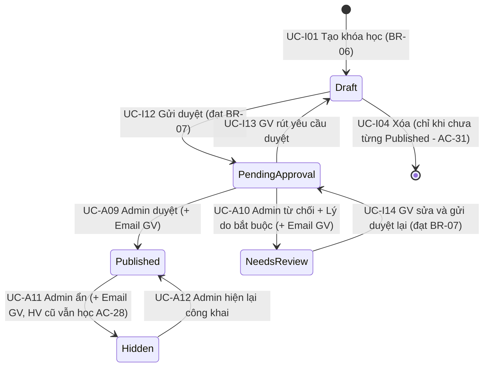
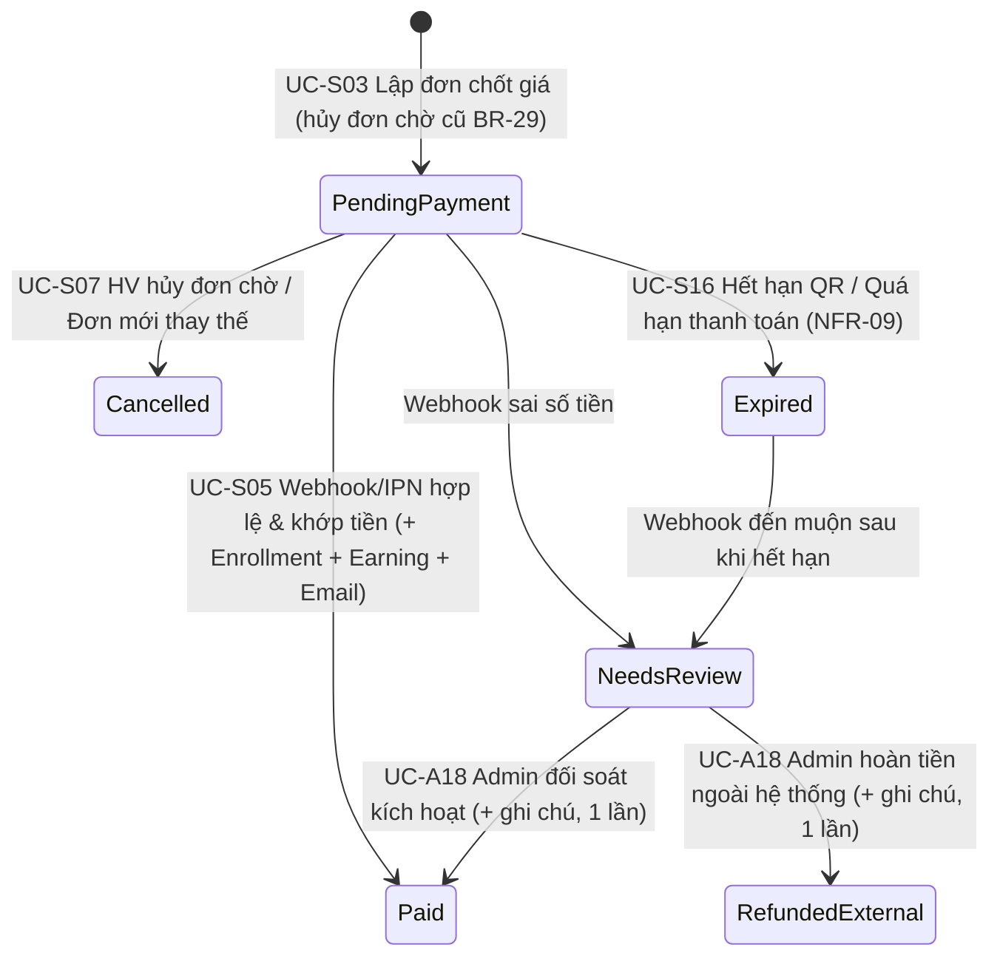
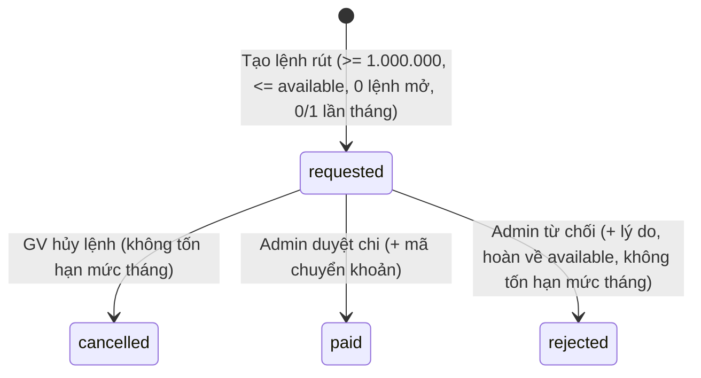

# EDU-TDS-W-001 — THIẾT KẾ KIỂM THỬ HỆ THỐNG EDUMY WEB (TEST DESIGN SPECIFICATION)

| Thuộc tính | Giá trị |
| :--- | :--- |
| **Mã tài liệu** | `EDU-TDS-W-001` |
| **Phiên bản** | `1.0` |
| **Chuẩn áp dụng** | ISO/IEC/IEEE 29119-3 (Test Design Specification) & 29119-4 (Test Design Techniques) |
| **Tham chiếu Kế hoạch** | [EDU-TP-W-001_Test_Plan.md](file:///c:/Users/bacle/Downloads/Edumy-Project/Edumy-main/docs/testing/web/EDU-TP-W-001_Test_Plan.md) |
| **Danh mục yêu cầu** | [requirements_inventory.csv](file:///c:/Users/bacle/Downloads/Edumy-Project/Edumy-main/docs/testing/web/requirements_inventory.csv) |
| **Bộ Test Case chi tiết** | [EDU-TCS-W-001_Test_Cases.xlsx](file:///c:/Users/bacle/Downloads/Edumy-Project/Edumy-main/docs/testing/web/EDU-TCS-W-001_Test_Cases.xlsx) |

---

## 1. Tổng quan cấu trúc thiết kế kiểm thử

Tài liệu này định nghĩa các **Điều kiện kiểm thử (Test Conditions)** và **Kịch bản kiểm thử (Test Scenarios — `TS-W-<Mxx|REG>-<NNN>`)** cho toàn bộ 8 phân hệ của Edumy Web cùng 9 nhóm phi chức năng theo ISO/IEC 25010 & OWASP Top 10 (2021) / ASVS L1.

### Sơ đồ chuyển trạng thái cốt lõi (State Transition Models)

#### 1.1. Vòng đời khóa học 5 trạng thái (`D-13`)

#### 1.2. Vòng đời đơn hàng & Thanh toán (`W-M04`)

#### 1.3. Vòng đời yêu cầu rút tiền (`W-M06`)

---

## 2. Kịch bản kiểm thử theo Module (Test Scenarios)

### Module W-M01: Tài khoản & Phân quyền (`TS-W-M01-001` .. `TS-W-M01-008`)

| Mã kịch bản | Điều kiện kiểm thử (Test Condition) | Truy vết | Kỹ thuật 29119-4 | Ưu tiên |
| :--- | :--- | :--- | :--- | :---: |
| `TS-W-M01-001` | Đăng ký tài khoản mới, kiểm tra trùng email, độ mạnh mật khẩu, email xác thực trong Mailpit | UC-G05, BR-01, BR-02, AC-05 | EP, BVA, Use Case | High |
| `TS-W-M01-002` | Xác thực email (mã đúng, mã sai, mã hết hạn, mã đã dùng) & gửi lại cooldown 60s | UC-G07, UC-G08, BR-34, AC-05, AC-06 | BVA, State Transition, Error Guessing | High |
| `TS-W-M01-003` | Đăng nhập Web (JWT + HttpOnly cookie), refresh cookie, đăng xuất, Google OAuth | UC-G06, UC-G12, AC-07, CODE-OAUTH-01 | Use Case, EP, Error Guessing | High |
| `TS-W-M01-004` | Quên mật khẩu (thông báo trung lập AC-25) và đặt lại mật khẩu (mã dùng 1 lần) | UC-G09, UC-G10, AC-25 | Use Case, State Transition | High |
| `TS-W-M01-005` | Hồ sơ cá nhân, đổi mật khẩu kết thúc phiên khác, đăng ký làm GV & chặn GV bị thu hồi | UC-G13, UC-S20, BR-05, AC-08, AC-26 | Use Case, Decision Table | High |
| `TS-W-M01-006` | Quản trị người dùng của Admin: thống kê, danh sách, khóa/mở tài khoản (chặn tự khóa & khóa Admin khác AC-37), cấp/thu hồi quyền GV | UC-A01..A05, BR-03, BR-04, BR-05, AC-09, AC-26, AC-37 | Decision Table, State Transition | High |
| `TS-W-M01-007` | Bảo mật xác thực & mật mã: BCrypt cost >= 12 (3.2), brute-force lần 6/15p (3.2), JWT `exp`/tamper/`alg:none` (3.2), lộ mật khẩu/mã | NFR-02, NFR-03, OWASP A02, A07 | BVA, Error Guessing | High |
| `TS-W-M01-008` | Bảo mật phân quyền Admin & API Mobile trong ma trận IDOR (8 vai trò) + Injection (SQLi/XSS hồ sơ) | NFR-01, OWASP A01, A03 | Decision Table, Error Guessing | High |

---

### Module W-M02: Khám phá khóa học (`TS-W-M02-001` .. `TS-W-M02-005`)

| Mã kịch bản | Điều kiện kiểm thử (Test Condition) | Truy vết | Kỹ thuật 29119-4 | Ưu tiên |
| :--- | :--- | :--- | :--- | :---: |
| `TS-W-M02-001` | Danh mục công khai chỉ hiện `Published` (D-08), phân trang 20 khóa/trang, ẩn trả 404 với người ngoài | UC-G01, BR-19, BR-21, D-08, AC-01 | EP, BVA | High |
| `TS-W-M02-002` | Tìm kiếm không dấu / không phân biệt hoa thường (D-09), instant search (`< 2` vs `>= 2` ký tự), gợi ý khi không có kết quả | UC-G02, BR-20, BR-21, D-09, AC-02 | EP, BVA, Error Guessing | High |
| `TS-W-M02-003` | Lọc danh mục × miễn phí/trả phí × 4 kiểu sắp xếp (`newest`, `rating`, `price_asc`, `price_desc`) | UC-G03, AC-03 | Pairwise | Medium |
| `TS-W-M02-004` | Xem chi tiết khóa học công khai, xem trước bài preview không tạo ghi danh, chặn bài không preview | UC-G04, UC-G11, BR-22, AC-04 | Decision Table, Use Case | High |
| `TS-W-M02-005` | Trang chủ, gợi ý khóa nổi bật/tương đồng/combo, lọc tag, và chống SQLi ở tìm kiếm/sort/filter | UC-G14, CODE-REC-01, OWASP A03 | EP, Error Guessing | Medium |

---

### Module W-M03: Biên soạn, Cộng tác & Xét duyệt (`TS-W-M03-001` .. `TS-W-M03-009`)

| Mã kịch bản | Điều kiện kiểm thử (Test Condition) | Truy vết | Kỹ thuật 29119-4 | Ưu tiên |
| :--- | :--- | :--- | :--- | :---: |
| `TS-W-M03-001` | Tạo khóa học nháp (UC-I01), kiểm chứng thiếu `categoryId` fallback=1 (3.2), danh mục ngừng sử dụng, slug trùng, bất nhất quy tắc giá (3.2) | UC-I01, BR-06, BR-08, BR-09, BR-16, AC-10 | EP, BVA, Error Guessing | High |
| `TS-W-M03-002` | Quản lý khóa học của GV: xem danh sách, cập nhật, chặn sửa khi `PendingApproval` (AC-27), xóa Draft vs chặn xóa khóa đã từng công khai (AC-31) | UC-I02..I04, BR-11, BR-12, AC-27, AC-31 | State Transition, Decision Table | High |
| `TS-W-M03-003` | Biên soạn giáo trình (`CourseCurriculumEditor`): CRUD chương, sắp xếp chương, CRUD bài học, sắp xếp bài, upload media/ảnh, gắn tag, tạo/xóa Quiz | UC-I05..I11, UC-I19, UC-I20 | Use Case, EP | High |
| `TS-W-M03-004` | Gửi duyệt khóa học theo checklist BR-07, kiểm chứng bypass qua `PUT /courses/{id}/status` (3.2), rút yêu cầu duyệt & nộp duyệt lại | UC-I12..I14, BR-07, BR-08, BR-10, AC-11, AC-12 | Decision Table, BVA, State Transition | High |
| `TS-W-M03-005` | Cộng tác đồng giảng viên: mời (email hợp lệ/không hợp lệ/tự mời/vượt 100% bps), email mời, chấp nhận/từ chối, sửa tỷ lệ, gỡ đồng GV, đồng GV rời khóa | UC-I15..I18, BR-17, BR-18, AC-13 | State Transition, BVA, Decision Table | High |
| `TS-W-M03-006` | Admin xét duyệt & điều hành khóa học: xem toàn sàn, duyệt `Published`, từ chối bắt buộc lý do `NeedsReview`, ẩn `Hidden`, hiện lại `Published` + email cho GV chính | UC-A09..A12, UC-A16, BR-10, BR-13, BR-14, D-13, AC-14..AC-16 | State Transition, Decision Table | High |
| `TS-W-M03-007` | Admin quản lý danh mục: xem thống kê, thêm/sửa/xóa danh mục trống, chặn xóa & chuyển ngừng sử dụng khi đã có khóa (D-21) | UC-A06..A08, BR-15, D-21, AC-17 | Decision Table, EP | Medium |
| `TS-W-M03-008` | Bảo mật biên soạn: IDOR course/section/lesson/co-instructor (GV-B sửa/xóa khóa GV-A), XSS lưu trữ ở tên/mô tả/bài viết | NFR-01, OWASP A01, A03, A04 | Decision Table, Error Guessing | High |
| `TS-W-M03-009` | Bảo mật upload file: sai định dạng, đổi đuôi giả mạo, quá 50MB, SVG chứa `<script>`, tên file path traversal (`../../`) | OWASP A03, A04, Upload Sec | BVA, Error Guessing | High |

---

### Module W-M04: Giỏ hàng, Đơn hàng & Thanh toán (`TS-W-M04-001` .. `TS-W-M04-008`)

| Mã kịch bản | Điều kiện kiểm thử (Test Condition) | Truy vết | Kỹ thuật 29119-4 | Ưu tiên |
| :--- | :--- | :--- | :--- | :---: |
| `TS-W-M04-001` | Giỏ hàng: thêm hợp lệ, xóa, chặn 4 trường hợp AC-29 (đã có, đã sở hữu, miễn phí, khóa của chính GV/đồng GV) | UC-S01, UC-S02, BR-23, AC-29 | Decision Table | High |
| `TS-W-M04-002` | Mã giảm giá (Coupon): tạo/gán/kiểm tra mã hợp lệ, hết hạn, không tồn tại, giảm giá khi checkout | CODE-CPN-01, UC-S03 | EP, BVA | Medium |
| `TS-W-M04-003` | Lập đơn hàng (Cart Checkout & Buy Now): chốt giá snapshot (đổi giá sau không đổi đơn), giới hạn tối đa 1 đơn chờ BR-29 thay thế đơn cũ, lịch sử & hủy đơn chờ | UC-S03, UC-S06, UC-S07, BR-24, BR-29, AC-18, AC-22 | State Transition, Use Case | High |
| `TS-W-M04-004` | Khởi tạo thanh toán VietQR, VNPay URL và Mock Gateway; polling trạng thái đơn | UC-S04, AC-19 | Use Case | High |
| `TS-W-M04-005` | Webhook thanh toán SePay & VNPay IPN: chữ ký đúng cấp quyền + doanh thu + email; sai/thiếu chữ ký từ chối; sai số tiền/đến muộn chuyển `needs_review` | UC-S05, BR-26, BR-28, AC-19..AC-21 | Decision Table, Error Guessing | High |
| `TS-W-M04-006` | Admin quản lý đơn hàng, giao dịch và đối soát thủ công UC-A18 (kích hoạt / hoàn tiền ngoài hệ thống, bắt buộc ghi chú, không xử lý lại) | UC-A13, UC-A14, UC-A18, BR-30, AC-21 | State Transition, Decision Table | High |
| `TS-W-M04-007` | Độ tin cậy thanh toán & tự hủy đơn quá hạn: webhook lặp 10 lần (NFR-04), ngắt backend giữa giao dịch, 2 luồng đồng thời, double-click checkout, scheduled auto-expire QR/Order (3.2) | UC-S16, BR-27, NFR-04, NFR-09, AC-20 | Error Guessing, State Transition | High |
| `TS-W-M04-008` | Bảo mật thanh toán: IDOR đơn hàng/QR giữa HV1-HV2, thao túng giá/số tiền/coupon ở payload client, gọi thẳng callback/webhook không qua xác thực | NFR-01, BR-25, OWASP A01, A04, A08 | Error Guessing, Decision Table | High |

---

### Module W-M05: Học tập, Tương tác & Chứng nhận (`TS-W-M05-001` .. `TS-W-M05-008`)

| Mã kịch bản | Điều kiện kiểm thử (Test Condition) | Truy vết | Kỹ thuật 29119-4 | Ưu tiên |
| :--- | :--- | :--- | :--- | :---: |
| `TS-W-M05-001` | Ghi danh miễn phí (khóa 0đ, chặn khóa trả phí, chặn GV tự ghi danh), danh sách Khóa học của tôi | UC-S08, UC-S09, BR-31, AC-22 | Decision Table, Use Case | High |
| `TS-W-M05-002` | Phòng học & tiến độ: đánh dấu/bỏ đánh dấu hoàn thành, công thức làm tròn xuống (1/3=33%, 2/3=66%, 10 bài), khóa bị ẩn học viên cũ vẫn học bình thường (AC-28) | UC-S10, UC-S11, BR-32, BR-36, AC-23, AC-28 | BVA, Use Case | High |
| `TS-W-M05-003` | Chứng chỉ hoàn thành: cấp đúng 1 chứng chỉ khi 100% (AC-34), snapshot tên khóa khi đổi tên sau đó (AC-35), tải PDF tiếng Việt có dấu, xác minh công khai mã đúng/sai (AC-36) | UC-S12..S14, BR-33, BR-35, AC-34..AC-36 | State Transition, EP | High |
| `TS-W-M05-004` | Đánh giá khóa học: tạo (1-5 sao, chặn chưa ghi danh, chặn đánh giá trùng), sửa, xóa; Admin ẩn đánh giá cập nhật điểm TB và chặn sửa (AC-30) | UC-S15, UC-A15, BR-37, BR-38, AC-30 | BVA, Decision Table, State Transition | Medium |
| `TS-W-M05-005` | Hỏi đáp Q&A: đặt câu hỏi (chặn chưa ghi danh & chặn lessonId khóa khác AC-32), sửa/xóa/resolve; chặn HV khác phản hồi, GV/đồng GV phản hồi gắn nhãn + gửi email (AC-33); hàng đợi GV; Admin ẩn & khôi phục | UC-S17, UC-S18, UC-I21, UC-I22, UC-A17, UC-A19, BR-39, BR-40, AC-24, AC-32, AC-33 | Decision Table, State Transition | High |
| `TS-W-M05-006` | Làm bài kiểm tra trắc nghiệm (Quiz): xem đề, nộp bài, chấm điểm đúng/sai, tính vào tiến độ hoàn thành | UC-S19, CODE-QZ-01 | EP, BVA | Medium |
| `TS-W-M05-007` | Danh sách yêu thích (Wishlist): thêm, xem, kiểm tra, xóa qua API & rà soát route trên Web Frontend | CODE-WL-01 | Use Case, Error Guessing | Low |
| `TS-W-M05-008` | Bảo mật học tập: IDOR enrollment/question/review/certificate PDF giữa HV1-HV2, XSS lưu trữ ở đánh giá & Q&A, rate-limit tra cứu chứng chỉ lần thứ 31/phút (NFR-03) | NFR-01, NFR-03, OWASP A01, A03 | BVA, Error Guessing | High |

---

### Module W-M06: Doanh thu & Rút tiền (`TS-W-M06-001` .. `TS-W-M06-005`)

| Mã kịch bản | Điều kiện kiểm thử (Test Condition) | Truy vết | Kỹ thuật 29119-4 | Ưu tiên |
| :--- | :--- | :--- | :--- | :---: |
| `TS-W-M06-001` | Sổ cái doanh thu (`payout_earnings`): tách phí nền tảng 30%, chia đồng GV theo `shareBps`, kiểm chứng kỳ hạn `BR-PAY-HOLD` (`hold-days=7`), API tổng quan/tháng/khóa/entries | BR-PAY-HOLD, BR-PAY-FEE, CODE-PAY-01 | BVA, EP | High |
| `TS-W-M06-002` | Tài khoản nhận tiền: cập nhật yêu cầu mật khẩu hiện tại (đúng/sai), response chỉ trả 4 số cuối (che số tài khoản NFR-02) | CODE-PAY-02, NFR-02 | Decision Table, EP | High |
| `TS-W-M06-003` | Yêu cầu rút tiền & hủy: biên tối thiểu `999.999` vs `1.000.000`, vượt số dư khả dụng, chưa có TK nhận tiền, lệnh mở trùng (409), lần thứ 2 trong tháng dương lịch (409), hủy khi `requested` vs chặn hủy khi đã `paid/rejected` | BR-PAY-MIN, BR-PAY-FREQ, CODE-PAY-03 | BVA, Decision Table, State Transition | High |
| `TS-W-M06-004` | Admin duyệt chi trả rút tiền (kèm mã chuyển khoản) và từ chối (bắt buộc lý do, hoàn trả số dư khả dụng và không tiêu hạn mức tháng) | CODE-PAY-04 | State Transition, Decision Table | High |
| `TS-W-M06-005` | Bảo mật & đồng thời rút tiền: IDOR rút tiền/TK nhận tiền giữa GV-A và GV-B, race condition gửi 2 request rút đồng thời (DB filtered unique index `UX_WithdrawalRequests_OpenPerInstructor`) | NFR-01, NFR-04, OWASP A01 | Error Guessing | High |

---

### Module W-M07: Vận hành, Hạ tầng & Phi chức năng hệ thống (`TS-W-M07-001` .. `TS-W-M07-010`)

| Mã kịch bản | Điều kiện kiểm thử (Test Condition) | Truy vết | Kỹ thuật 29119-4 | Ưu tiên |
| :--- | :--- | :--- | :--- | :---: |
| `TS-W-M07-001` | Toàn bộ danh mục 9-10 loại email hệ thống gửi vào Mailpit đúng người/nội dung tiếng Việt; cô lập lỗi SMTP không làm hỏng nghiệp vụ chính | BR-41 | Use Case, Error Guessing | High |
| `TS-W-M07-002` | Bảo mật cấu hình & vận hành (OWASP A05/A09): Actuator exposure, CORS, Swagger/api-docs profile không phải dev, stack trace, security headers, mật khẩu mặc định Grafana/SQL Server, quét secrets trong repo | NFR-08, OWASP A05, A09 | Error Guessing | High |
| `TS-W-M07-003` | Hiệu năng tải đồng thời 50 CCU (p95 <= 3s), tạo PDF chứng chỉ (<= 5s), tạo khóa 5 chương x 3 bài, Lighthouse Performance | NFR-05 | BVA, Performance | High |
| `TS-W-M07-004` | Sao lưu & Phục hồi CSDL: BACKUP → RESTORE vào container SQL Server tạm, đối chiếu row count, đo RTO (<= 4h), kiểm tra lịch sao lưu hằng ngày (RPO 24h) | NFR-06 | Use Case, Error Guessing | High |
| `TS-W-M07-005` | Quan sát hệ thống (Observability): truy trọn vòng đời 1 đơn hàng từ log không lộ secret, `/actuator/health`, `/actuator/prometheus`, Prometheus scrape UP, Grafana dashboard | NFR-08 | Use Case | Medium |
| `TS-W-M07-006` | Khả dụng (Usability): Responsive 360/768/1366px, tiếng Việt, thông báo lỗi rõ trường, trạng thái trống/lỗi, điều hướng bàn phím, Lighthouse Accessibility >= 90 | NFR-07 | Pairwise, Use Case | Medium |
| `TS-W-M07-007` | Tương thích đa trình duyệt: chạy lại bộ TC High cốt lõi trên Chrome, Edge, Firefox mới nhất | NFR-10 | Pairwise | Medium |
| `TS-W-M07-008` | Khả năng bảo trì (Maintainability): `./mvnw verify` (ModularityTest) + JaCoCo, Frontend `npm run lint` & `npm run build`, rà soát mã chết / route không dùng (S4) | NFR-10 | Use Case | Medium |
| `TS-W-M07-009` | Triển khai (Deployability): khởi chạy stack Docker sạch đủ 6/6 service healthy + đo thời gian; xác minh cục bộ các stage trong `Jenkinsfile` | NFR-10 | Use Case | Medium |

---

### Module W-REG: Hồi quy các thay đổi gần nhất (`TS-W-REG-001` .. `TS-W-REG-002`)

| Mã kịch bản | Điều kiện kiểm thử (Test Condition) | Truy vết | Kỹ thuật 29119-4 | Ưu tiên |
| :--- | :--- | :--- | :--- | :---: |
| `TS-W-REG-001` | Tạo khóa học 1 trang (`CourseCreate.jsx`): tạo trọn bộ (thông tin + thumbnail + nhiều chương/bài + mời đồng GV), validation từng trường, lỗi một phần (partial failure khi mời đồng GV sai email), chống double-submit | REG-01, UC-I20 | Use Case, Error Guessing | High |
| `TS-W-REG-002` | Gỡ bỏ hoàn toàn AI/ML: grep toàn mã nguồn Backend/Frontend/SQL/UI tìm `MLTest`, `ml-analyses`, `NeedsReanalysis`, `Analyzing`, `ml-monitoring` (mục tiêu = 0 dấu vết) | REG-02 | Error Guessing | High |
